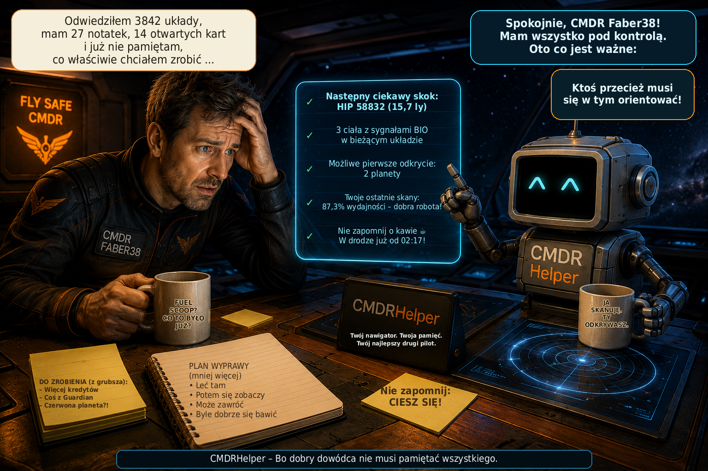

# CMDRHelper

[🇩🇪 Deutsch](README_DE.md) \| [🇬🇧 English](README.md) \| [🇫🇷
Français](README_FR.md) \| [🇮🇹 Italiano](README_IT.md) \| [🇳🇴
Norsk](README_NO.md) \| [🇸🇪 Svenska](README_SV.md) \| [🇫🇮
Suomi](README_FI.md) \| [🇵🇱 Polski](README_PL.md) \| [🇳🇱
Nederlands](README_NL.md) \| [🇪🇸 Español](README_ES.md) \| [🇹🇷
Türkçe](README_TR.md) \| [🇬🇷 Ελληνικά](README_EL.md)



**Osobisty towarzysz Elite Dangerous – eksploracja, nawigacja i dane dowódcy w jednym miejscu**

CMDRHelper to samodzielna aplikacja komputerowa analizująca lokalne dzienniki Elite Dangerous i korzystająca z planetarnych danych pozycji z `Status.json`. Pomaga rozpoznawać interesujące ciała niebieskie, wracać do zapisanych miejsc oraz przeglądać podróże i odkrycia. Dane osobiste pozostają po ponownym uruchomieniu i są rozdzielone według dowódców.

## 🚀 Szybki start

Pobierz **ZIP najnowszego wydania CMDRHelper** (`CMDRHelper_v*.zip`) z [GitHub Releases](https://github.com/Faber38/CMDRHelper/releases/latest), z sekcji **Assets**, i rozpakuj całe archiwum do osobnego folderu.

### Windows

1. Uruchom **`install.bat` jeden raz** w rozpakowanym folderze. Skonfiguruje lokalne środowisko Python (`venv`) i zależności. Jeśli brakuje odpowiedniego Pythona, może zainstalować go automatycznie przez `winget` za Twoją zgodą; narzędzie `winget` musi być dostępne.
2. Po instalacji uruchamiaj program przez **`start.bat`**. Używaj tego pliku także przy kolejnych uruchomieniach.

### Linux

Python **3.10 lub nowszy** z odpowiednim modułem `venv` musi być już zainstalowany. Otwórz terminal w rozpakowanym folderze i wykonaj jeden raz:

```bash
bash install.sh
```

Skrypt konfiguruje lokalne środowisko i zależności; nie instaluje pakietów systemowych. Następnie uruchamiaj CMDRHelper, również przy kolejnych uruchomieniach, poleceniem **`bash start.sh`**.

### Pierwsze uruchomienie i aktualizacje

Folder dzienników Elite Dangerous jest wykrywany automatycznie, jeśli to możliwe. Jeśli go brakuje lub jest nieprawidłowy, wybierz go w **Ustawieniach**.

CMDRHelper sprawdza aktualizacje przy uruchomieniu i ma wbudowany mechanizm aktualizacji. Potwierdź proponowaną aktualizację w aplikacji; zaktualizuje ona program i zależności oraz uruchomi CMDRHelper ponownie. Po pierwszej instalacji zwykle wystarczy używać `start.bat` (Windows) lub `bash start.sh` (Linux). Przy zwykłych aktualizacjach nie trzeba ponownie ręcznie uruchamiać `install.bat` ani `install.sh`.

## CMDRHelper v3.9.19

- Kolumna górnicza „Własna cena sprzedaży / t” pokazuje ostatnią zarejestrowaną sprzedaż wybranego dowódcy. Nowsza, niższa cena również zastępuje starszą.
- Podpowiedź sprzedaży pokazuje datę i godzinę, stację, system, ilość i cenę za tonę, jeśli dane są znane. Oferty rynkowe i ceny zakupu nie są traktowane jako własna sprzedaż.
- Same zmiany zapasów podczas wydobycia nie uruchamiają zadania cenowego ani nie zapisują ponownie niezmienionych komórek cen. MarketSell aktualizuje ceny; zmiana dowódcy natychmiast usuwa poprzednie ceny osobiste.
- Dzienna kronika PP2 ma kompaktowy filtr systemów z wielokrotnym wyborem, „Wszystkie systemy” i „Nieznany system”. Wraz z filtrem czasu określa widoczne zdarzenia i zasługi w filtrze.
- Filtr systemów resetuje się przy zmianie dnia lub dowódcy i zachowuje wybór po nadejściu nowych zdarzeń tego samego dnia. Obsługiwane jest odłączanie i dokowanie; menu korzysta z istniejących danych dnia bez nowego dziennego zapytania SQL.
- Schemat bazy danych pozostaje 23. Ukierunkowane testy na danych syntetycznych z Qt offscreen obejmują dwanaście języków oraz tryb ciemny i jasny. Bez pełnej regresji i natywnych testów Windows.

## CMDRHelper v3.9.18

- Aktualizacja konserwacyjna i poprawiająca niezawodność wysyłania dzienników EDSM; bez nowych funkcji.
- Górny wskaźnik EDSM i podpowiedź oceniają tylko wysyłanie: zielony OK, żółty Oczekiwanie, czerwony Błąd, szary Nieznany lub Wyłączony. Pobieranie, trafienia pamięci podręcznej i testy połączenia nie zmieniają koloru.
- Odpowiedzi HTTP, zbiorcze i indywidualne są sprawdzane łącznie. Brakujące lub nieznane potwierdzenia nie zwalniają punktu kontrolnego; 500/501 nie potwierdzają zapisu.
- 100–103 świadczą o rejestracji; 104/304 mogą zakończyć zdarzenia, ale same nie zmieniają wskaźnika na zielony. Tylko jednoznacznie zakończony początkowy ciąg przesuwa punkt kontrolny.
- Punkty końcowe, rozmiar partii, limity czasu, odstępy ponowień, kolejność wysyłania i przypisanie dowódcy/FID pozostają bez zmian. Oryginalne dzienniki bez zmian; schemat bazy nadal 23.
- Potwierdzone zdarzenia za luką mogą zostać wysłane ponownie. Odrzucone zdarzenia nie są automatycznie pomijane; po ponownym uruchomieniu wskaźnik zaczyna bez dowodu powodzenia. Brak natywnej weryfikacji Windows.

## CMDRHelper v3.9.17

- Zewnętrzne wyszukiwanie układów w Explorer nad bieżącym układem: Enter lub przycisk uruchamia asynchroniczne rozpoznawanie nazwy przez Spansh. Istniejąca mapa pokazuje gwiazdy, planety, księżyce i obiekty w osobnym oknie o zmiennym rozmiarze, bez wymuszania pierwszego planu; kliknięcie otwiera szczegóły ciała.
- Dane ciał Spansh, jednoznacznie zidentyfikowane lokalne pamięci EDSM i kroniki wszystkich dowódców są łączone ze źródłami i konfliktami. Własne dowody skanowania i mapowania pozostają przypisane właściwemu dowódcy; dane zewnętrzne nie są własnymi odkryciami. Kronika jest tylko odczytywana.
- Planety umożliwiające lądowanie są wyraźnie oznaczone. Szczegóły pokazują typ, grawitację, atmosferę i znane materiały; niepotwierdzone udziały Spansh nie są wyświetlane jako procenty. Spansh/EDSM nie gwarantują konkretnych obszarów wydobycia Rhino ani ich surowców.
- Zakończone zadania wyszukiwania Explorer i ich obiekty sygnałów są zwalniane; nieaktualne wyniki są odrzucane. Powtarzane wyszukiwania nie gromadzą obiektów QRunnable.
- Dzienna kronika PP2 ponownie wykorzystuje niezmienione dane i tabele. Nowe zasługi i późniejsze korekty aktualizują widok; filtry dnia i czasu, zmiana dowódcy i odłączona kronika nadal działają.
- Okna zewnętrzne pokazują migawki. Pamięci EDSM bez jednoznacznej tożsamości układu nie są łączone. Schemat bazy pozostaje 23; informacje w dwunastu językach. Natywny test w Windows pozostaje do wykonania.

## CMDRHelper v3.9.16

- Sekcje PP2 bieżącego systemu, aktywności i artykułów na pokładzie można zwijać osobno: przy pierwszym użyciu są zamknięte, a później ich stan jest zapisywany. Twoja potęga i kronika dnia pozostają widoczne.
- Przy niejasnym rodzaju aktywności pojawia się krótka ogólna wskazówka o przechwytywaniu innych dowódców, bez potwierdzania lokalnej dostępności. Jednoznaczne aktywności, oznaczenia Ethos i zabezpieczenia pozostają zachowane.
- Obce potęgi kontrolujące bieżący system mają obok nazwy istniejący portret o rozmiarze 42 × 56 pikseli. Twoja potęga nie otrzymuje dodatkowego portretu.
- Czterostopniowy wykres kontroli dla kontrolowanych systemów jest o około 25 % niższy, wraz z podpisami i legendą. Pozycje znaczników, czerwone/niebieskie zabarwienie i obliczenia CP pozostają bez zmian.

## CMDRHelper v3.9.15

- Bardziej kompaktowe karty konfliktów PP2 dla nieokupowanych systemów: portrety, paski i odstępy są mniejsze o około 25%; tekst zmniejszono z 12 do 10 pikseli, aby zachować czytelność.
- Przy co najmniej trzech uczestniczących potęgach i odpowiedniej szerokości okna dwie prowadzące potęgi są po lewej, a wszystkie pozostałe po prawej. Wąskie okna i najwyżej dwie potęgi zachowują jedną kolumnę.
- Istniejąca karta systemu wykorzystuje szerokość pod wskazówkami działań i artykułami na pokładzie, nie zasłaniając ich. Obie kolumny konfliktu zaczynają się na tej samej wysokości i zajmują mniej miejsca w pionie; wszyscy uczestnicy pozostają widoczni.

## CMDRHelper v3.9.14

- Przebudowany widok konfliktów PP2 dla nieokupowanych systemów: większe istniejące portrety potęg, nazwa i punkty kontroli w elastycznym układzie; zachowano sortowanie według postępu i dotychczasowe kolory.
- Punkty kontroli konfliktu jako przybliżenie poparte obserwacjami: CP ≈ ConflictProgress × 120000. Pasek używa zakładanej skali od 0 do 180000 CP, ograniczonej do 100%; brakujące wartości pozostają nieznane.
- Przerywane znaczniki przy 36000 CP (20%) i 120000 CP (66,67%), z symbolami i przetłumaczonymi podpowiedziami. Granice i skala nie są potwierdzonymi oficjalnymi stałymi gry; przekroczenie znacznika nie zmienia statusu systemu.
- Własna potęga bez obecności jest wyświetlana osobno z opisem „Brak obecności”, bez powielania uczestników. Warianty nazwy tej samej potęgi są łączone.
- Misje Odyssey: generowane szczegóły uwzględniają późniejsze zmiany celu. Jawne pierwotne cele z MissionRedirected są zapisywane osobno dla każdego dowódcy; nowy cel pozostaje celem nawigacji. Brakujące miejsca i planety nie są zgadywane.
- Główne okno zapisuje rozmiar, pozycję i stan maksymalizacji oraz przywraca je po ponownym uruchomieniu. Nieprawidłowa zapisana geometria jest zastępowana domyślną; niewidoczne pozycje są korygowane.

## CMDRHelper v3.9.13

- Kontrola systemów PP2: cztery kolorowe obszary dla stanów Niezajęty, Eksploatowany, Ufortyfikowany i Twierdza; biały trójkąt oznacza stan systemu, a żółty postęp bieżącego cyklu.
- Pozycje znaczników są wyraźnie oznaczone jako przybliżone, bez potwierdzonego obliczenia Frontier. Przedział jest czerwony, gdy biały znacznik znajduje się na prawo od żółtego, i niebieski, gdy jest na lewo. Wzmocnienie i osłabienie pokazują niezmienione wartości z dziennika w CP.
- Osobny widok konfliktu PP2 dla nieokupowanych systemów: potęgi posortowane według postępu konfliktu, ze względnymi paskami i istniejącymi portretami. Potwierdzone kolory dla Aisling Duval i Nakato Kaine, pozostałe neutralne; brakujące wartości pozostają nieznane, a bezwzględne CP konfliktu są niedostępne.
- Wykorzystano wszystkie dwanaście istniejących portretów potęg; A. Lavigny-Duval wskazuje Arissę Lavigny-Duval. Zachowano dotychczasowe widoki zastępcze.
- Misje: sortowanie wszystkich siedmiu kolumn rosnąco i malejąco, nagród liczbowo, a terminów chronologicznie; sortowanie jest zapisywane przez QSettings.
- Szczegóły pozostają przypisane do właściwej misji po sortowaniu i odświeżeniu; zmiana dowódcy usuwa poprzednie zaznaczenie. Nowe teksty PP2 są dostępne we wszystkich dwunastu językach.

## CMDRHelper v3.9.12

- Dodatkowe okna Explorer: niezawodne odświeżanie i sortowanie według wartości we wszystkich dwunastu językach.
- Odłączanie i dokowanie kroniki zdarzeń PP2: dowolna zmiana rozmiaru okna, zapamiętywanie rozmiaru i położenia oraz zachowanie filtrów. Suma zasług w jednym wierszu dla wyświetlanych wydarzeń dnia i wybranego filtra czasu, z uwzględnieniem nieprzypisanych zasług.
- Sterowanie śledzeniem aktywnego dowódcy bezpośrednio w przeglądzie; ustawienie zsynchronizowane z widokiem CMDR i zachowywane po ponownym uruchomieniu. Przy ręcznym wyborze dowódcy żółta wskazówka wyjaśnia, że automatyczny wybór jest wyłączony; miga przez dziesięć sekund, a potem pozostaje widoczna.
- Ulubione: kopiowanie nazw systemów ikoną kopiowania bez zaznaczania i nawigacji; zielony znacznik potwierdza skopiowanie przez dwie sekundy.
- Długie aktywne dzienniki: ponowne użycie zweryfikowanych wyników, uniknięcie podwójnej rekonstrukcji stanu i krótsze przerwy w działaniu interfejsu.
- Przywrócone okno postępu uruchamiania: wspólny widok dla włączonych źródeł dzienników i poprawne zgłaszanie błędów pierwszego importu.

## CMDRHelper v3.9.11

- Windows: automatyczne śledzenie po potwierdzeniu procesu Elite, bieżącego dziennika i FID dowódcy; zgodność ze starszymi ustawieniami śledzenia.
- Asystent handlu: rekomendacje korzystają z obserwatora rynku wybranego źródła dziennika, bez danych stacji z innych źródeł.
- Kronika PP2: szczegóły w jednym wierszu z separatorem „ | ”, wielokropkiem przy braku miejsca i pełnymi podpowiedziami.
- Niemodalne okna dodatkowe pozostają zawsze na wierzchu; okno główne i modalne okna dialogowe bez zmian.

## CMDRHelper v3.9.10

- Katalogi dzienników: wiele źródeł z wykrywaniem Steam/Heroic, edycją, polami wyboru monitorowania i osobnymi statystykami.
- Dowódcy: przypisanie zweryfikowane przez FID, zapamiętany wybór i opcjonalne automatyczne śledzenie jednoznacznie rozpoznanej instancji gry w systemie Linux.
- Powerplay 2.0: opcjonalny filtr godziny, zwarte wiersze transportu i lepsze przypisywanie skanów statków dla +1 do +100 zasług oraz nowych pełnych skanów wcześniej widzianych celów.
- Dodatkowe okna pozostają niezależnie otwarte po zminimalizowaniu głównego okna i zamykają się przy wyjściu z programu.
- EDSM i Inara: osobne przełączniki wysyłania i odbierania EDSM, pozycje wysyłania dla każdego źródła, wiarygodne potwierdzenia i lepsza obsługa ponownych prób.
- Bardziej niezawodne przetwarzanie dzienników z transakcyjnymi pozycjami odczytu i kontrolą tożsamości; diagnostyka widoku Odyssey chroniąca prywatność w pakiecie diagnostycznym.

## CMDRHelper v3.9.9

- Przenieś nawigację planetarną do osobnego okna i z powrotem, zachowując cel i dane na żywo.
- Otwieraj obrazy ulubionych w oryginalnej rozdzielczości, powiększaj kółkiem myszy i przesuwaj przeciąganiem.
- Tytuły ulubionych są żółte w kolorze Elite (#FFCC33); zaznaczenie i pozostałe wiersze tekstu pozostają bez zmian.
- Eksportuj wszystkie lub wybrane ulubione z obrazami i współrzędnymi w dotychczasowym zgodnym formacie ZIP/JSON.
- Czytelniejsza nawigacja z symbolem kompasu i przyciskiem „Do nawigacji planetarnej”.

## CMDRHelper v3.9.8

- Ulubione i nawigacja planetarna są zintegrowane bezpośrednio z głównym interfejsem jako dwie karty.
- Nawigacja otwiera wspólną stronę główną bez dodatkowych okien ulubionych lub nawigatora.
- Gdy skrót klawiszowy nie jest ustawiony, wskazówka szybkiego ulubionego pojawia się w żółtym kolorze Elite, delikatnie miga trzy razy i objaśnia konfigurację w sekcji Ustawienia.
- Zintegrowana pomoc opisuje nowe karty i ścieżki obsługi we wszystkich dwunastu językach.

## CMDRHelper v3.9.6.7

- Ulepszone przypisywanie zasług Powerplay do skanów statków i sprzedaży towarów.
- Skany statków uwzględniają +5 i +10 zasług; zwykła sprzedaż może otrzymać kilka przyznań zasług w ciągu czterech sekund (≈). Konkurencyjne lub niejednoznaczne zdarzenia pozostają nierozstrzygnięte (?).
- Włączone widoki ładowni pozostają widoczne bez ukrywania przy braku aktywności; wartości ładunku i dronów aktualizują się bez ponownego otwierania widoków.
- Nowe rozwijane menu główne Nawigacja zawiera Ulubione i Nawigację planetarną zamiast dotychczasowych przycisków w Explorerze.
- Wbudowana pomoc opisuje nowe ścieżki menu we wszystkich dwunastu obsługiwanych językach.

## CMDRHelper v3.9.6.6

- Ulepszone przypisywanie zasług Powerplay do kolejnych transakcji sprzedaży towarów.

## CMDRHelper v3.9.6.5

- Stabilniejszy start w Windows: Niekrytyczne błędy w tle są zgłaszane jako częściowe, a główne okno pozostaje dostępne.
- Ograniczone ponowienia odczytu danych lądowisk i uzupełniania dziennika, ulepszona naprawa kartografii oraz bezpieczniejsze indeksowanie i zamykanie.
- Dokładniejsze techniczne kategorie błędów w diagnostyce przy zachowaniu anonimizacji danych osobowych.
- Spokojniejsze wyświetlanie ładowni podczas wydobycia dzięki ponownemu użyciu okien i wierszy; automatyczne ukrycie dopiero 15 sekund po ostatniej zmianie zapasów.
- Spójne przetłumaczone nazwy towarów bez zmian obliczeń zapasów ani osobnego wyświetlania dronów.
- Dzienna kronika PP2: Zwykłą sprzedaż towarów również można ostrożnie powiązać z zasługami (≈); niejednoznaczne przypadki zachowują ?, a suma i obliczanie rangi pozostają bez zmian.

## CMDRHelper v3.9.5

- Nowa ocena Odyssey: 192 z 223 przedmiotów mają rangę A–D; 31 pozostaje oznaczonych ? do czasu weryfikacji.
- Kolorowa kolumna rang z podpowiedziami i zapamiętanym sortowaniem A–D lub D–A; osobiste oznaczenia porządkowania pozostają niezależne.
- Poprawione trasy lotniskowców: cała potwierdzona zajęta pojemność trafia do Spansh, a tryt w zbiorniku i magazynie jest przekazywany oddzielnie.
- CarrierStats pobiera pojemność i dane zbiornika z kontrolą tożsamości, sesji i aktualności; zmagazynowany tryt nadal wpisuje się ręcznie.
- Czytelniejsze wskazówki, wyróżnione nieprawidłowe pola i trzy pomarańczowe mignięcia przy braku potwierdzenia, w obu motywach i dwunastu językach.
- Dodatkowa ochrona przed nieaktualnymi potwierdzeniami i spóźnionymi wynikami tras po zmianie kontekstu; eksport CTSVision pozostaje zgodny.

## CMDRHelper v3.9.4

- Ulepszony planer tras z obsługą FSD SCO 7A oraz poprawnym uwzględnianiem modyfikacji, wzmacniaczy Guardian, ładunku i paliwa rezerwowego.
- Nowy asystent danych statku wyjaśnia, uzupełnia i zapisuje brakujące wartości dla każdego statku; potwierdzone dane automatyczne mają pierwszeństwo.
- Dokładniejsze powiązanie czasowe dostaw Powerplay z komunikatami o zasługach w ciągu trzech sekund przy jednoznacznym kontekście.
- Widoki górnictwa, Odyssey, materiałów i floty unikają zbędnego przebudowywania i ponownie wykorzystują istniejące elementy.
- Nowa pomoc w porządkowaniu Odyssey: 81 domyślnych kandydatów, własny wybór spośród 223 przedmiotów, oznaczenia kolorami i zapamiętane sortowanie.
- Ulepszona walidacja danych, komunikaty błędów i wskaźniki ładowania oraz zaktualizowane teksty we wszystkich dwunastu językach.

## CMDRHelper v3.9.3

- Trzy nowe obrazy stacji, lepsze przypisywanie typów i poprawione oznaczenia stacji planetarnych.
- Potwierdzone usługi Interstellar Factors są wyświetlane na turkusowo obok nazwy stacji.
- Galeria obrazów ładuje się w tle z holograficznym skanerem ładowania i ochroną przed wielokrotnym klikaniem.
- Postęp rangi Powerplay jest wyświetlany na zielono lub pomarańczowo; poprawiono priorytet i zapisywanie zasług.
- Przyznane zasługi można czasowo powiązać ze sprzedażą rzadkich towarów w ciągu dwóch sekund, gdy kontekst jest jednoznaczny.
- Zaktualizowany portret Nakato Kaine i poprawione teksty we wszystkich dwunastu językach.

## CMDRHelper v3.9.2

- Nowe wyszukiwanie rzadkich towarów w pobliżu z zapisywaniem celów na liście handlowej.
- Ulepszone wyświetlanie zapasów materiałów przy sprzecznych danych gry.
- Rozszerzona i doprecyzowana pomoc Powerplay 2.0.
- Liczne ulepszenia tłumaczeń.
- Dalsze poprawki stabilności.

## CMDRHelper v3.9.1

- Lista aktywności Powerplay pokazuje teraz aktywności Ethos oznaczone przez Elite.
- Odpowiednio uzupełniono pomoc Powerplay.
- Dodano podziękowania dla wspierających dowódców i grupy graczy EOT.
- Drobne ulepszenia i poprawki.

## CMDRHelper v3.9.0

- Rzadkie towary zintegrowano z asystentem handlowym.
- Stacje pochodzenia rzadkich towarów są rozpoznawane i w razie potrzeby automatycznie wyszukiwane.
- Ulepszone rozpoznawanie ładunku z bezpośrednim wyborem przewożonych towarów do wyszukiwania miejsc sprzedaży.
- Wyszukuj odpowiednie stacje sprzedaży dla kilku przewożonych towarów jednocześnie.
- Znacznie rozszerzona pomoc dotycząca Powerplay 2.0.
- Dalsze ulepszenia stabilności i niezawodności.

## CMDRHelper v3.8.3

- Naprawiono błąd, który uniemożliwiał aktualizowanie nowych lokalnych danych rynkowych po przyjęciu niektórych misji.
- Poprawiono stabilność monitorowania lokalnych rynków.

## CMDRHelper v3.8.2

- Poprawki błędów i ulepszenia asystenta handlu.
- Bardziej niezawodne rozpoznawanie ładowni, stacji i lokalnych rynków.
- Ulepszone informacje o lądowiskach i widok stacji.
- Szybsze przetwarzanie danych stacji i lądowisk.
- Drobne ulepszenia obsługi i wskaźników stanu.

## CMDRHelper v3.8.0

- Nowa karta handlu „Sprzedaj tutaj”: znajdź tanie źródła towarów, które można sprzedać z zyskiem na bieżącym rynku.
- Lepiej wykorzystaj obie strony podróży: z wpisu zapamiętanej stacji zaopatrzenia wyszukaj towary na drogę tam, a następnie kup na miejscu zaplanowany towar na powrót.
- Więcej informacji o źródłach: oddzielna podaż i popyt oraz znane ciała niebieskie dla stacji powierzchniowych.
- Wyszukiwanie wyłącznie w danych lokalnych obejmuje też kupno i sprzedaż oraz lepiej uwzględnia znane rozmiary lądowisk.
- Pewniejsze wykrywanie ładowni: potwierdzone ilości pozostają ważne przy niezmienionym, prawidłowym kontekście; statek, SRV i tryb pieszy są lepiej rozróżniane.
- Rynek stacji pozostaje rozpoznany po wejściu na pokład własnego statku, bez ponownego dokowania.

## CMDRHelper v3.7.8

- Poprawki błędów w asystencie handlowym.
- Ulepszone wykrywanie i aktualizacja przestrzeni ładunkowej.
- Naprawiono błędy stanu materiałów przy limicie pojemności.
- Ogólne poprawki stabilności i niezawodności.

## Wersja wewnętrzna 3.7.5

Wersja wewnętrzna do testów podczas gry; nieopublikowana.

- Explorer: status EDSM i normalizacja klas gwiazd, zachowane uzupełnianie brakujących ciał niebieskich, pierwsze zejście na powierzchnię między sesjami z poprawionym scalaniem, automatyczna szerokość i liniowy układ listy wartości. Ikona kopiowania ostatnich systemów; zaktualizowana pomoc, tłumaczenia i testy.
- [Szczegółowe informacje (po niemiecku)](docs/release-3.7.5.md)

## Nowości w wersji 3.7.0

- Nowy dział Handel: sprzedaż i zakup łączą własne zaobserwowane rynki z ofertami Spansh. Po błędzie wyszukiwania społecznościowego pasujące wyniki lokalne pozostają dostępne, oznaczone jako niepełne.
- Otwarcie rynku towarów w Elite automatycznie zapisuje rynek stacji. Własne obserwacje przetrwają restart, są ważne przez mniej niż 24 godziny i zastępują starsze oferty tego samego rynku.
- Rekomendacje używają bieżącego własnego rynku zakupu, wolnej ładowni, podaży i popytu. Minimalna marża, możliwa ilość i możliwy zysk pomagają wybrać ofertę; cele można ograniczyć do własnych rynków.
- Handel pokazuje postęp, diagnostykę do skopiowania i stan rynku. Zapamiętany lot handlowy zachowuje towar i cel; można skopiować nazwę systemu docelowego.
- Pełny widok systemu może jednorazowo dopasować się do okna przy otwarciu. Opcja jest domyślnie włączona i zapamiętywana; ręczne przybliżanie pozostaje dostępne.
- Pomoc w aplikacji sprawdzono i uzupełniono w dwunastu tematach i językach, poprawiając tłumaczenia i duże czcionki. Zapasy górnicze carriera są zachowywane przy krótkich dziennikach zamknięcia.

## Nowości w wersji 3.6.2

- Obligacje bojowe w sekcji „Misje i nagrody”: kwoty według frakcji, suma i lokalne zerowanie.
- Obligacje rejestrowane na żywo są zachowywane osobno dla dowódców po restarcie; zweryfikowane punkty dziennika zapobiegają podwójnemu naliczaniu.
- Nagrody za głowy, obligacje bojowe i Odyssey współdzielą odczyt bieżącego dziennika z niezależnymi potwierdzeniami.
- Jednoznaczna realizacja usuwa obserwowane saldo wskazanej frakcji; stare środki i kwota realizacji nie wpływają na inne frakcje.
- Śmierć usuwa obserwowane niezrealizowane obligacje bojowe; odrodzenie i utrata SRV nie powodują dodatkowego zerowania.
- Nagrody za głowy i obligacje bojowe pozostają rozdzielone. Luki w rejestracji i błędy zapisu są wyraźnie oznaczane.

## Nowości w wersji 3.6.1

- Bieżące nagrody za głowy w Misjach, zapisywane trwale i osobno dla każdego dowódcy.
- Zlecenia ze spotkań w kosmosie i od posłańców są widoczne przed uzyskaniem ostatecznego MissionID.
- Oferty ze spotkań pozostają po ponownym uruchomieniu i po jednoznacznym potwierdzeniu stają się zwykłymi misjami bez duplikatów.
- Lepsze dopasowanie towaru, ilości, celu, nagrody i czasu; niejednoznaczne oferty nie są dopasowywane na ślepo. Niepotwierdzone oferty wygasają po 24 godzinach.
- Dowódca → Misje pokazuje bieżące misje. Nowe zakończenia nie powiększają już archiwum misji; istniejące wiersze historyczne pozostają zachowane.
- Przetwarzanie spotkań jest ponownie w pełni podłączone; stare zdarzenia nie nadpisują nowszego stanu misji. Usunięto sprzeczny reset misji.

## Nowości w wersji 3.6

- Stacje i placówki na mapie układu oraz osobna karta stacji z wyszukiwaniem, filtrami i sortowaniem.
- Obrazy stacji, przeglądarka obrazów i szczegóły znanych usług, lądowisk, źródeł oraz dat.
- Opcjonalne informacje Spansh w Ustawienia → Usługi online, domyślnie wyłączone. Po udanym pobraniu kolejne ręczne żądania tego samego lokalnego dnia są blokowane. Bez Spansh karta informuje o ograniczeniach danych dziennika.
- Własne obrazy statków i carriera, obrazy typów/domyślne oraz przeglądarka. Usuwanie statków z floty i przywracanie przez ponowny odczyt wszystkich statków; pewniejsze rozpoznawanie sprzedanych statków.
- Ulepszona mapa, lista wartości z kolorowym stanem mapowania, Cargo HUD i nawigacja. Mniejsze obciążenie w Linuksie oraz przy zrzutach ekranu, galerii i Explorerze.
- Naprawiono: nieszkodliwe krótkie dzienniki Elite nie przerywają już ciągłości zapasów górniczych carriera. Dane nieznane lub niepewne pozostają wyraźnie oznaczone.

## Nowości w wersji 3.5

- Szybsza kronika i interfejs; przetwarzanie BIO i kartografii działa w tle.
- Odyssey pokazuje szafkę, plecak, osobistą zajętość kategorii i obliczony zapas lotniskowca.
- Konfiguracja przez ! wyraźnie odróżnia potwierdzone 0 od nieznanego —.
- Zapas lotniskowca jest oddzielony od miejsca zarezerwowanego przez zlecenia kupna u barmana.
- Pewniejsze zapasy Mining: bezpieczniejsze dane Cargo, nadrabianie transferów i sprawdzony zapis.
- Naprawiono żądanie migracji po nowej instalacji; ulepszono kopiowanie w kronice i aktualizację ukrytych widoków.

Szafka i plecak korzystają ze sprawdzonych aktualnych danych ShipLocker/Backpack. Towary, Materiały i Dane mają osobną pojemność osobistej szafki 1000. Suma obejmuje szafkę + plecak + lotniskowiec tylko przy znanych, spójnych wartościach. Zakupy, sprzedaż i wymiany są odróżniane od prywatnych transferów. Po restarcie odtwarzana jest lokalizacja i ustalana nowa osobista baza; pominięte transfery Odyssey nie są zgadywane. Przykład fikcyjny: 500 jednostek + 100 miejsc na zakupy = 600 / 1000. Te 100 nie są materiałami. Stare lub niepewne dane rynkowe nie dają rzekomo aktualnej zajętości.

### Konfiguracja zapasu lotniskowca

CMDRHelper może automatycznie aktualizować prywatny zapas Odyssey Twojego lotniskowca. Najpierw potrzebuje potwierdzonego stanu początkowego.

Na własnym lotniskowcu otwórz transfer ekwipunku i porównaj Towary, Materiały i Dane.

Kliknij dwukrotnie kolumnę Lotniskowiec i wpisz aktualną ilość dla KAŻDEJ pozycji. Potwierdź również WSZYSTKIE puste pozycje wartością 0.

— = jeszcze niepotwierdzone / nieznane
0 = wyraźnie potwierdzony pusty zapas

Po pełnej konfiguracji CMDRHelper śledzi transfery między osobistą szafką a lotniskowcem, gdy jednoznacznie przebywasz na własnym lotniskowcu. Osobiste zmiany poza nim nie zmieniają jego zapasu.

Każdą wartość można poprawić lub ponownie potwierdzić dwukrotnym kliknięciem.

Otwarte zlecenia kupna u barmana dodatkowo rezerwują miejsce. Zajętość w grze może przekraczać sumę obecnych materiałów. Handel u barmana, zwłaszcza innych graczy, może zmieniać rzeczywisty zapas. W razie potrzeby sprawdź i ponownie potwierdź obliczony stan.

Mining rozdziela Statek, SRV i Lotniskowiec. Jawne CargoTransfer są nadrabiane dokładnie raz przez zweryfikowane granice dzienników; Cargo.json i zapisane punkty kontrolne są sprawdzane rygorystyczniej. To nie logika różnic Odyssey. Handel innych graczy może wymagać ponownego potwierdzenia. Nowe bazy otrzymują znacznik Parent-Hierarchy po inicjalizacji, więc pierwszy import nie wywołuje błędnej migracji historycznej. Stare bazy bez znacznika nadal wymagają migracji przy wyłączonym Elite. ⧉ kopiuje nazwy kroniki, a ✓ krótko potwierdza. Misje są wczytywane selektywniej, a ukryte widoki nie są niepotrzebnie przebudowywane.

## Nowości w wersji 3.4.6

- Stabilniejszy import archiwum przy dużych zbiorach dzienników.
- Sprawniej reagujący interfejs podczas długiego przetwarzania danych.
- Lepsze uzupełnianie danych z nowych i powiększonych dzienników po imporcie.
- Szybsze przetwarzanie archiwum i odświeżanie danych wydobycia.
- Kliknij nazwę systemu w otwartym widoku systemu w kronice, aby ją skopiować.
- Poprawiono wyświetlanie kart w trybie ciemnym w systemie Windows.

## Nowości w wersji 3.4.5

- Stabilniejszy import archiwum przy dużych zbiorach dzienników.
- Sprawniej reagujący interfejs podczas długiego przetwarzania danych.
- Lepsze uzupełnianie danych z nowych i powiększonych dzienników po imporcie.
- Szybsze przetwarzanie archiwum i odświeżanie danych wydobycia.
- Kliknij nazwę systemu w otwartym widoku systemu w kronice, aby ją skopiować.
- Dalsze ulepszenia wydajności i stabilności.
- Poprawiono wyświetlanie kart w trybie ciemnym w systemie Windows.

## Nowości w wersji 3.4.4 – Hotfix

- Naprawiono błędy związane z bardzo dużymi identyfikatorami misji, zapewniając niezawodny zapis misji.
- Po błędzie zapisu przetwarzanie dziennika ponawia próbę z coraz dłuższymi przerwami, bez pomijania wpisów.
- Usprawniono uruchamianie, gdy aktywny dowódca nie został jeszcze rozpoznany.
- Ulepszono diagnostykę techniczną tych błędów bez zapisywania konkretnych identyfikatorów misji w logach.

## Nowości w wersji 3.4.3

- Rozszerzone ulubione: filtr odległości oraz przenośny eksport/import ZIP wraz z obrazami.
- Sortowanie tabel Explorer i osobne zapisywanie sortowania oraz szerokości kolumn dla każdej tabeli.
- Górnictwo pokazuje oddzielnie SRV, statek, lotniskowiec i sumę; filtr zapasów uwzględnia wszystkie trzy magazyny.
- Pakiety diagnostyczne i rotacyjne logi chroniące prywatność na potrzeby pomocy technicznej, bez automatycznego wysyłania.
- Bezpieczna aktualizacja bazy bezpośrednio ze starszych wersji; kopie migracji pozostają zachowane przez całą wersję, która je utworzyła.
- Lepsza obsługa, aktualna pomoc i wyraźnie klikalne punkty na mapie kroniki.

Filtr odległości jest początkowo wyłączony (domyślnie 500 lat świetlnych), używa lokalnych współrzędnych i odświeża się przy zmianie układu. Eksport ulubionych zawiera favorites.json i dostępne obrazy; duplikaty można pominąć, zastąpić lub zaimportować jako nowe. Lista wartości i tabele BIO/GEO/GÓRNICTWO obsługują sortowanie naturalne, numeryczne i semantyczne. Wcześniejsza instalacja wersji 3.4.1 nie jest wymagana.

## Nowości w wersji 3.4.1

- Poprawia starsze zapisane hierarchie układów
- Lepsze wyświetlanie planet, księżyców i układów wielokrotnych
- Bezpieczna aktualizacja bazy z automatyczną kopią i wycofaniem zmian przy błędach
- Dzienniki Elite pozostają bez zmian
- Dalsze poprawki stabilności i wyświetlania

Aktualizacja bazy poprawia stare zapisane powiązania gwiazd, planet i księżyców. Dzienniki są tylko odczytywane. Najpierw zamknij Elite Dangerous i w miarę możliwości udostępnij historyczne dzienniki. Wcześniej powstaje pełna kopia bazy CMDRHelper; w razie błędu zmiany są wycofywane, a kopia jest przywracana, jeśli to konieczne. Kopia pozostaje jako zabezpieczenie. Anuluj pozwala odłożyć aktualizację.

## Nowości w wersji 3.4 – Mining i zapasy

- Nowa sekcja Mining z towarami, cenami orientacyjnymi i klasami wartości.
- Zapasy statku/SRV i ręcznie potwierdzone zapasy carriera z automatycznym śledzeniem transferów.
- Łączone wyszukiwanie i filtry wydobycia planetarnego oraz asteroid/pierścieni.
- ABBAU ×N otwiera bezpośrednio odpowiedni widok Mining.
- Poprawne wartości kartograficzne przy zmianie sesji.
- Ulepszona pomoc, wygląd tabel i obsługa.

Wspólna tabela zawiera 57 towarów górniczych o pochodzeniu Surface, Asteroid lub Both. Znane ceny referencyjne i wynikające z nich klasy wartości pozostają stałymi wskazówkami, a nie danymi rynkowymi na żywo.

Zweryfikowany ładunek statku/SRV; dwukrotne kliknięcie pozwala potwierdzić, skorygować lub zresetować zapas carriera do nieznanego. Tylko jednoznaczne zdarzenia CargoTransfer do/z własnego carriera aktualizują potwierdzony zapas początkowy. Suma pojawia się tylko przy obu znanych ilościach; nieznane pozostaje —.

Filtry dodatniego zapasu, klasy i pochodzenia można łączyć; ich stany, sortowanie i szerokości kolumn są zapisywane. ABBAU ×N automatycznie wybiera wydobycie planetarne. Ręczne odświeżanie ładunku ma animację stanu i zachowuje wartości carriera.

Ulepszony wygląd tabeli Mining, podpowiedzi carriera i zintegrowana pomoc Mining niezależna od wersji. Kursor dłoni na już interaktywnych ciałach i przyciskach mapy systemu. Poprawka zastępczego wpisu A-6-a zachowuje poprawne wartości kartograficzne między sesjami.

## Nowości w wersji 3.3.1 – Poprawki błędów

- Ukończone mapowanie DSS jest teraz niezawodnie wykrywane na bieżąco.
- Mapowanie zostaje zachowane nawet wtedy, gdy odpowiedni skan pojawi się później w bieżącym dzienniku.
- Stan i czas twojego mapowania oraz wydajność sond są niezawodnie zapisywane.
- Import archiwum nie zastępuje już istniejących wartości skanowania i mapowania błędnymi zerami.
- Obiekty dotknięte błędem, posiadające kompletne dane, odzyskują poprawne wyświetlane wartości przy wczytaniu lub odświeżeniu.
- Szacunki wartości mapowania w Live uwzględniają teraz prawidłowe premie; ułamki kredytu są odrzucane dopiero na końcu.
- Współczynniki korekcyjne wyuczone ze sprzedaży nie zmieniają już zwykłych wartości eksploracji.
- Dodatkowe testy regresji obejmują mapowanie między sesjami i trwałe zapisywanie danych mapowania.

## Nowości w wersji 3.3

- Nowa analiza systemu oparta na osobistym doświadczeniu eksploracyjnym.
- Tryb gry Otwarty / Solo / Grupa prywatna bezpośrednio w przeglądzie.
- Kopiowanie nazw ostatnich systemów jednym kliknięciem.
- Czytelniejsze dane historyczne i bardziej zrozumiała analiza.
- Pewniejszy import archiwum dzienników uzupełnionych w późniejszym czasie.

Dotychczasowa wskazówka skoku nazywa się teraz Analiza i zawiera Analizę systemu oraz nadal dostępne dane historyczne. Analiza porównuje cel z twoją osobistą historią: kod masy daje oszacowanie bazowe, ostrożnie doprecyzowywane przez region i rodzinę. Indeks potencjału 100 odpowiada twojej osobistej średniej historycznej stłumionego potencjału eksploracyjnego, a nie prawdopodobieństwu procentowemu. Podstawa danych i ich wiarygodność pozostają oddzielone od oceny; końcowy numer nie wpływa na wynik, a BIO ma obecnie wyłącznie charakter informacyjny.

## Nowości w v3.2 względem v3.1

- Zarządzanie materiałami inżynieryjnymi: wszystkie 146 materiałów Raw, Manufactured i Encoded wraz z klasami, pojemnościami i wyjątkami. Aktualne zapasy dowódcy, wyszukiwanie, filtry, pięć subtelnych teł wierszy oraz zapisana szerokość i kolejność kolumn ułatwiają przeglądanie. Nieznany stan pozostaje odróżniony od zera.

- Ekwipunek Odyssey: czwarta karta zawiera 223 tożsamości katalogowe towarów, komponentów, danych i przedmiotów zużywalnych. Schowek, plecak i wiarygodna suma pozostają oddzielne; widoczne są stosy misji, status i zastosowania inżynieryjne. Dodatnie ilości mają złoty kolor. Brakujące tłumaczenia nazw zastępuje angielski.

- Wyszukiwanie handlarzy materiałami (Znajdź handlarza → Otwórz planer trasy): na żądanie Spansh szuka osobno Raw, Manufactured i Encoded od bieżącego systemu dowódcy. Carriery są wykluczane, a dane stacji weryfikowane. Odległość w ly jest bezpośrednia między systemami; dane społeczności nie gwarantują dostępu. Przekazanie do planera ustawia tylko system docelowy i nie uruchamia trasy. Brak wyszukiwania handlarzy Odyssey.

- Widok całego systemu: nowy układ w stylu Elite zastępuje miniaturę w Explorerze i Kronice. Gwiazdy i planety tworzą główną strukturę, a księżyce odgałęziają się poniżej; układy wielogwiazdowe pozostają czytelne. Zoom, przewijanie, dopasowanie do okna i kliknięcie ciała umożliwiają dostęp do szczegółów.

- Zwarte pasy asteroid: skupiska są grupowane w pasy w widoku ogólnym oraz zwykłych mapach Explorera i Kroniki. Wszystkie dane poszczególnych skupisk są zachowane.

- Poprawiona kartografia: skan po mapowaniu DSS nie zeruje już niesprzedanych wartości eksploracji, czasu mapowania ani wydajności. Błędne wpisy są naprawiane przy starcie z dostępnych dzienników jednoznacznie przypisanych do dowódcy. Bez źródeł naprawa oczekuje; nie trzeba usuwać bazy danych.

- Ulepszony planer tras: start automatycznie śledzi bieżący system do ręcznego wpisania innego; wyczyszczenie pola przywraca automatykę. Statki i carriery używają dokładnie sprawdzonych adresów ID64 zamiast podobnych nazw. „Unable to find route” oznacza brak znalezionej trasy; sprawdź cele, zasięg i ustawienia.

- Lepsza informacja o aktualizacji: okno Tak/Nie pokazuje wersję zainstalowaną i dostępną oraz do sześciu zmian, jeśli istnieje podsumowanie. Długie listy można przewijać, a działania pozostają dostępne. Widok jest instalowany z v3.2; niezmieniony klient v3.1 jeszcze go nie pokazuje.

## v3.1 (v3.0.3 → v3.1)

- Postęp BIO jest zwięzły: 1/3 żółte, 2/3 niebieskie i 3/3 zielone; ukończony stan „Gotowe” też jest zielony. W „pokazuj automatycznie” GEO ma własny zapisywany przełącznik: tylko BIO, tylko GEO lub oba razem. Ręcznie zmienione szerokości kolumn wspólnej tabeli BIO / GEO / ABBAU w Eksploratorze pozostają po ponownym otwarciu i restarcie programu. Szerokości kolumn okien podręcznych są przywracane odporniej na błędy; nieprawidłowe wartości zastępują bezpieczne szerokości domyślne.

- Odkrycie i mapowanie są rozdzielone i odnoszą się do chwili twojego skanowania: „Już odkryte w chwili twojego skanu” oraz „Już zmapowane w chwili twojego skanu”. Brakujące dane pozostają Nieznane. Kandydaci do First Discovery i First Mapping dotyczą tylko chwili skanowania; historyczne Nie nie dowodzi, że ciało nadal jest nieodkryte lub niezmapowane dzisiaj. Własne mapowanie nie potwierdza oficjalnego pierwszeństwa. Obecność w EDSM pozostaje odrębna.

- „HUD statusu EDSM” w „pokazuj automatycznie” jest domyślnie WYŁĄCZONY. Po wejściu do systemu nad Elite pojawia się komunikat na około 2,5 sekundy. „EDSM: ZNANY” oznacza prawidłowy wynik EDSM dla systemu. „EDSM: NIEZNANY” oznacza prawidłową odpowiedź EDSM bez wyniku dla systemu. „EDSM: BRAK ODPOWIEDZI” oznacza błąd sieci, HTTP, przekroczenie czasu lub nieprawidłową odpowiedź, nigdy potwierdzony brak wyniku. Obecność w EDSM nie jest oficjalnym odkryciem w Elite; nie obiecuje się nazw pierwszych odkrywców ani zgłaszających. Komunikat działa niezależnie od HUD nawigacji i ładowni.

- Historia wizyt uwzględnia Location, FSDJump i CarrierJump także podczas bieżącego odczytu dziennika. Wiele zdarzeń pozycji w ramach jednego nieprzerwanego pobytu liczy się jako jedna wizyta: A → A → A liczy się raz. Prawdziwy powrót jest zachowany: A → B → C → A to cztery wizyty.

- Ukończenie własnego mapowania DSS zapisuje teraz niezawodnie czas mapowania, użyte sondy i cel wydajności. Późniejsze skanowania nie powodują już utraty istniejących informacji.

- Okno ładowni automatycznie dostosowuje wysokość do zawartości. Przy wielu wpisach wysokość jest ograniczona, a tabelę można przewijać; wybrana szerokość i pozycja okna pozostają zachowane. Istniejący przełącznik „HUD ładowni” znajduje się teraz w „pokazuj automatycznie”, bez dodatkowego przełącznika w oknie ładowni.

- W istniejących instalacjach zwykle wystarczy: zainstalować aktualizację → uruchomić CMDRHelper. Niezbędne historyczne poprawki danych BIO, wizyt i metadanych DSS wykonują się automatycznie; przed naprawami zapisującymi dane powstaje kopia zapasowa bazy. Naprawy są wersjonowane i idempotentne: pomyślnych rewizji nie wykonuje się w całości przy każdym starcie. Odtworzenie wymaga dzienników Elite, które nadal istnieją, są czytelne i jednoznacznie przypisane do commandera. Brakujące źródła nie są wymyślane ani uznawane za sukces; niedokończone naprawy są ponawiane przy kolejnym starcie. Zwykle nie potrzeba usuwania bazy, ręcznych skryptów ani ponownego importu.

## Explorer

Explorer przedstawia bieżący system w trzech widokach:

- **Mapa systemu:** graficzne przedstawienie znanych gwiazd, planet i księżyców. Kliknięcie ciała niebieskiego otwiera szczegóły. „Pokaż wszystko” otwiera przegląd systemu.
- **Lista wartości:** Lista wartości pokazuje szacunki według zapisanego skanowania, a nie gwarantowane zaległe wypłaty. Premie za pierwszeństwo pozostają niepotwierdzone. Podpowiedzi mapy i listy oraz szczegóły ciała używają tych samych stanów odniesionych do czasu skanowania.
- **BIO / GEO / ABBAU:** sygnały biologiczne i geologiczne, planetarne miejsca wydobycia i potwierdzone osobiste znaleziska.

Analizy rozróżniają zgłoszone sygnały i rzeczywiste osobiste znaleziska. **BIO ×N** oznacza zgłoszoną liczbę sygnałów, a nie potwierdzenie w pełni przeanalizowanych gatunków. **WYDOBYCIE ×N** liczy planetarne miejsca wydobycia bez ujawniania ich poszczególnych surowców. Osobiście wydobyte towary, materiały poboczne zebrane podczas wydobycia i ogólny skład materiałowy ciała pozostają rozdzielone.

Explorer pokazuje także szacunkowe wartości BIO, postęp osobistych analiz oraz niesprzedane dane kartograficzne i BIO. Wartości opierają się na dostępnych informacjach dziennika i ciał; brakujące dane nie są przedstawiane jako osobiste odkrycia. Dodatkowe dane EDSM to informacje zewnętrzne, które należy odróżniać od własnych znalezisk.

Szczegóły ciał obejmują dostępne właściwości fizyczne, atmosferę, pierścienie, materiały i informacje o odkryciach. Wizualizacje używają odpowiednich tekstur, a dla wybranych szczególnych obiektów astronomicznych także animacji. Sekcja Cargo pokazuje znany ładunek i pojemność obecnie używanego statku lub SRV; w przypadku Rhino ładunek i osobiste znaleziska wydobywcze pozostają odrębnymi danymi.

Wybierz „Nawigacja” po lewej. Po prawej pojawią się karty „★ Ulubione” i „Nawigacja planetarna”, z domyślnie aktywną kartą „★ Ulubione”. „Nawigacja → ★ Ulubione” zarządza systemami, planetami/księżycami i miejscami na powierzchni aktywnego dowódcy; „Nawigacja → Nawigacja planetarna” wyświetla nawigację planetarną w tym samym obszarze głównym.

## Nawigacja planetarna

Nawigator planetarny służy wyłącznie do dolotu do określonej **szerokości/długości geograficznej na planecie lub księżycu**. Podróżom między systemami gwiezdnymi służy osobny planer tras.

### Wpisz cel i leć

Wybierz docelowe ciało lub użyj bieżącego, rozpoznawanego automatycznie, gdy to możliwe. Wpisz szerokość i długość geograficzną oraz opcjonalną nazwę celu. Nie musisz podawać technicznych danych, takich jak BodyID czy SystemAddress. **0,0** także jest prawidłową współrzędną.

Gdy Elite dostarczy prawidłowe planetarne dane pozycji dla odpowiedniego ciała, kompas aktywuje się automatycznie. Bez pasujących danych nawigator pokazuje stan oczekiwania. W każdej chwili możesz ustawić nowy cel współrzędnych na tym samym ciele; zastępuje on poprzedni.

### Widok podczas dolotu

| Odległość do celu | Widok |
| --- | --- |
| **Więcej niż 380 km** | Kula planety z własną pozycją jako białym okręgiem i celem jako małą kropką. Cel jest pomarańczowy po widocznej stronie, a czerwony po niewidocznej stronie tylnej. Pozycja gracza pozostaje stała na ekranie; planeta i cel są przedstawiane względem niej. |
| **Do 380 km włącznie** | Automatyczne przejście na nachyloną siatkę perspektywiczną z **odstępami odległości 50 km** i zaznaczoną pozycją celu do dalszego dolotu. |

Kula i siatka perspektywiczna dopasowują się proporcjonalnie do dostępnego miejsca. Przy wąskim lub niskim oknie głównym przewijaj zawartość. Zmiana strony lub karty zachowuje filtry i cel nawigacji.

### Znaczenie wartości nawigacyjnych

- **Współrzędne celu:** zapisana szerokość i długość geograficzna celu.
- **Aktualne współrzędne:** ostatnia prawidłowa własna pozycja planetarna.
- **Odległość do celu / Odległość po powierzchni:** obliczona odległość do celu po powierzchni kuli; duży odczyt i wartość szczegółowa pokazują tę samą odległość z różnym zaokrągleniem.
- **Namiar:** bezwzględny kierunek od bieżącej pozycji do celu.
- **Heading:** bieżące własne ustawienie zgłoszone przez Elite.
- **Kierunek względny:** różnica między headingiem a namiarem, np. „23° w prawo”, „w lewo” lub „prosto”.
- **Kurs do celu:** bezwzględny kurs, na który możesz skręcić według HUD-u Elite. Odpowiada namiarowi i nie jest dodatkowym względnym kątem skrętu.

Przykład: **Heading 051° → Kurs do celu 074° = 23° w prawo**.

Nawigacja zależy od danych stanu gry; aktualizacje mogą przychodzić z opóźnieniem zależnie od jej stanu. Odległość po powierzchni nie jest trasą terenową ani drogową. Przeszkody i wysokości terenu na trasie nie są uwzględniane.

## HUD nawigacyjny

Po lewej pod **pokazuj automatycznie → HUD nawigacji** możesz włączyć opcjonalny dodatkowy widok bezpośrednio nad Elite. Przy prawidłowej nawigacji planetarnej pokazuje:

- kierunek względny,
- bezwzględny kurs do celu,
- odległość.

HUD jest przezroczysty, przepuszcza kliknięcia i nie przejmuje fokusu: nie odbiera grze kliknięć myszy ani fokusu wprowadzania. Bez prawidłowej nawigacji staje się automatycznie niewidoczny; pole na pasku bocznym może pozostać zaznaczone. Zwykły nawigator działa niezależnie od HUD-u.

HUD został przetestowany w grze pod **Linux/X11** oraz **Windows 11 z Elite**. W Windows dopasowanie wielu monitorów opiera się na ich geometrii i pozycji okna Elite, a nie zgodności nazw monitorów.

## Ulubione

Wybierz „Nawigacja” po lewej. Po prawej pojawią się karty „★ Ulubione” i „Nawigacja planetarna”, z domyślnie aktywną kartą „★ Ulubione”. „Nawigacja → ★ Ulubione” zarządza systemami, planetami/księżycami i miejscami na powierzchni aktywnego dowódcy; „Nawigacja → Nawigacja planetarna” wyświetla nawigację planetarną w tym samym obszarze głównym. Ulubione należą do **aktywnego dowódcy**. Zmiana dowódcy odświeża widok; wybór dowódców w kronice nie rozszerza listy ulubionych.

### Zapisywanie trzech typów

Górny wiersz działań oferuje:

| Działanie | Zapisany ulubiony |
| --- | --- |
| **★ Zapisz bieżący system** | Bieżący system bez współrzędnych powierzchniowych. |
| **★ Zapisz planetę / księżyc** | Wybrana znana planeta lub księżyc bieżącego systemu bez współrzędnych powierzchniowych. |
| **★ Zapisz bieżącą pozycję** | Miejsce na powierzchni z bieżącym systemem, ciałem, szerokością i długością geograficzną. |

Przycisk pozycji pozostaje zawsze widoczny i jest dostępny tylko przy prawidłowych bieżących planetarnych danych pozycji i aktywnym dowódcy. **Kliknięcie utrwala dowódcę, system, ciało i współrzędne przed otwarciem okna edycji.** Późniejsze ruchy w grze nie zmieniają tej pozycji. Ten sam sposób zapisu jest dostępny w nawigatorze planetarnym. Znane wewnętrzne identyfikatory są przejmowane automatycznie; współrzędne nie są wymyślane.

Nadaj nazwę i dokładnie jedną kategorię: **Bio, Geo, Wydobycie, Widok, Lądowisko, Ciekawe lub Inne**. Notatka i obraz są opcjonalne.

### Wyszukiwanie, oglądanie i edycja

Przewijana lista, posortowana alfabetycznie według nazw, pokazuje nazwę, typ, system, w odpowiednich przypadkach ciało i współrzędne, kategorię i mały podgląd obrazu. **Wyszukiwanie tekstowe oraz filtry typu i kategorii** można łączyć. Wyszukiwanie obejmuje nazwę, system, ciało i notatkę.

**Otwórz / Pokaż** wyświetla zapisane informacje, notatkę i większy podgląd obrazu. **Pokaż w Explorerze** używa istniejącego przeglądu systemu lub szczegółów ciała, jeśli ulubiony należy do bieżącego systemu Explorera i są dostępne odpowiednie dane. Dla innych systemów zapisane informacje ulubionego pozostają dostępne.

**Edytuj** zmienia nazwę, kategorię, notatkę i obraz. System, ciało i zapisane współrzędne nie są zastępowane wartościami na żywo. Dla innej pozycji utwórz nowy ulubiony powierzchniowy.

**Usuń** wymaga potwierdzenia i usuwa wyłącznie rekord ulubionego i jego wewnętrzną kopię obrazu. Dane Explorera, dziennika i ciał zostają zachowane.

### Obrazy ulubionych i ostatni zrzut ekranu

Obrazy ulubionych są **całkowicie oddzielone od zwykłej sekcji Obrazy**. CMDRHelper zarządza własną wewnętrzną kopią w folderze obrazów ulubionych (`data/favorites/images/` przy standardowym układzie danych). Oryginał nie jest przenoszony ani zmieniany.

- **Wybierz obraz …** przyjmuje PNG, JPEG lub WebP i pokazuje podgląd. Wewnętrzna kopia powstaje dopiero przy zapisie.
- **Użyj ostatniego zrzutu ekranu** przy każdym kliknięciu ponownie skanuje rzeczywisty folder źródłowy zrzutów. Uwzględnia też odpowiednie przekonwertowane zrzuty Elite w folderze aktywnego dowódcy wewnątrz skonfigurowanego celu konwersji. Nowy zrzut pozostaje więc dostępny, jeśli automatyczna konwersja usunęła już jego BMP.
- Proponowane są czytelne pliki o pasujących nazwach Elite lub konwersji, a nie dowolne obrazy z ogólnych folderów. Kolejność określa jednoznaczny czas wykonania w nazwie pliku, a w przeciwnym razie czas pliku. Dla obrazów po konwersji używany jest czas wykonania zapisany w nazwie, a nie czas konwersji.
- Przed przyjęciem znalezionego zrzutu widzisz nazwę pliku, czas wykonania i świeżo wczytany podgląd. Potwierdź przez **Użyj tego obrazu**. Jeśli nie znaleziono pasującego zrzutu, wybór ręczny pozostaje dostępny. CMDRHelper sam nie wykonuje zrzutów ekranu.

Obraz można później zastąpić lub usunąć. Niepotrzebne kopie wewnętrzne są usuwane przy zapisywaniu lub usuwaniu ulubionego. **Działania na ulubionych nigdy nie usuwają oryginalnego zrzutu ani wybranego oryginalnego obrazu.** Gdy brakuje wewnętrznego pliku obrazu, ulubiony działa bez podglądu.

### Ulubiony powierzchniowy jako cel

**▶ Do celu** przekazuje zapisane ciało, szerokość, długość geograficzną i nazwę ulubionego do istniejącego nawigatora planetarnego, zastępując jego poprzedni cel. Ulubione nie mają własnej logiki nawigacji. Odpowiednie prawidłowe dane planetarne uruchamiają nawigację; w przeciwnym razie nawigator czeka jak dotąd.

Ulubionych innych dowódców nie można używać jako własnych celów. Zmiana dowódcy kończy cel nadal obsługiwany jako ulubiony cel poprzedniego dowódcy. Ulubione systemów i ciał wyświetlają istniejące informacje, bez własnego planowania tras.

## Kronika

Kronika to zapisana historia twoich podróży i znalezisk. Jej **mapa podróży 3D** pokazuje odwiedzone systemy i trasy dowódców. Szczegóły systemów i ciał pomagają odnaleźć znane informacje BIO, GEO, o materiałach, Codex i wydobyciu.

### Połączone filtry

**Zastosuj** lub **Enter w polu tekstowym** uruchamia razem wszystkie ustawione filtry:

- tekst,
- opcjonalne **Od** i **Do**,
- **Planetarne miejsca wydobycia** i **Co najmniej**,
- **Moje odkrycia wydobywcze** i **Towar**.

Termin z **Pomocy wyszukiwania / Legendy** trafia do pola wyszukiwania i jest uruchamiany razem z już ustawionymi filtrami okresu i wydobycia.

### Okres w UTC

Od i Do aktywuje się oddzielnymi polami wyboru. Można ustawić jedną granicę; bez zaznaczenia danej granicy nie ma ograniczenia czasu z tej strony. **Od** włącza początek wybranego dnia kalendarzowego UTC. **Do** obejmuje cały wybrany dzień UTC. UTC jest wspólną podstawą czasu, a nie twoim lokalnym czasem kalendarzowym.

Decydują **rzeczywiste wizyty w systemach**: co najmniej jedna zapisana wizyta musi mieścić się w okresie. Sam pierwszy lub ostatni moment poznania systemu nie zastępuje wizyty. Przy aktywnym okresie liczba wizyt oraz pierwsza i ostatnia wizyta na mapie dotyczą przefiltrowanych wizyt.

Okres filtruje wizyty, a nie pojedyncze zdarzenia odkryć, BIO, GEO czy wydobycia. Znane informacje o znaleziskach i osobiste ilości wydobycia pozostają zapisanymi **wartościami całkowitymi**. **„Miedź 56 t” przy aktywnym okresie nie oznacza automatycznie „56 t w tym okresie”.** Jeśli Od jest późniejsze niż Do, pojawia się błąd i nie rozpoczyna się zapytanie do bazy.

### Dowódca i odświeżanie

**Wybór dowódców mapy** określa wyświetlane trasy. Osobiste wyszukiwania tekstowe i wydobywcze dotyczą natomiast oglądanego lub aktywnego dowódcy. Pola wyboru mapy nie rozszerzają automatycznie osobistego wyszukiwania na wielu dowódców.

**Odśwież kronikę** ponownie ładuje dane i uruchamia aktywne filtry. **Bieżąca pozycja** najpierw stosuje bieżące filtry, a następnie centruje aktualny system tylko wtedy, gdy znajduje się on na wynikowej mapie. W przeciwnym razie pojawia się komunikat; filtry zostają zachowane.

**Resetuj** czyści tekst, wyłącza Od/Do i przywraca widoczne pola dat. Pola wydobycia są odznaczane, minimalna liczba staje się 0, a towar Wszystkie. Wybór dowódców pozostaje; następnie ładowana jest zwykła kronika.

Przy **braku wyników** mapa i trasy są czyszczone, lista wyników czyszczona i ukrywana, szczegóły resetowane, a otwarte okno szczegółów systemu kroniki zamykane. Stare wyniki nie pozostają na ekranie.

### Obsługa mapy

- Przeciągnij lewym przyciskiem myszy: obrót.
- Przeciągnij prawym przyciskiem: przesunięcie.
- Przeciągnij środkowym przyciskiem: narysowanie ramki powiększenia.
- Kółko myszy: powiększanie.
- **Wyrównaj:** przywraca orientację do galaktycznego widoku z góry; przesunięcie i powiększenie pozostają zachowane.

## Obrazy i automatyczna konwersja zrzutów ekranu

W sekcji **Obrazy** ustawiasz folder źródłowy zrzutów Elite i cel konwersji. Automatyczna konwersja przetwarza nowe BMP na **PNG lub JPEG**. Dostępne jest regulowane rozjaśnianie. BMP istniejące już przy uruchomieniu nie są automatycznie przetwarzane wstecz przez samo włączenie monitorowania; służy do tego konwersja ręczna.

Nazwy przekonwertowanych plików zawierają czas wykonania, dowódcę i system; pliki są przechowywane według dowódców. Automatyczne przypisanie podąża za dowódcą aktywnego dziennika. Inny wybór galerii nie zmienia tego aktywnego dowódcy.

Opcja **usunięcia oryginalnego BMP po pomyślnej konwersji** należy wyłącznie do tej konwersji i ma własne ustawienie. Jest niezależna od zarządzania obrazami ulubionych.

Galeria pokazuje odpowiednie przekonwertowane obrazy z podglądem. Przy ponownym wyświetleniu jest odczytywana na nowo; odświeżanie również uwzględnia aktualne pliki. Wybór i duży podgląd aktualizują się wspólnie. Gdy wybrany obraz znika, wybierany jest istniejący obraz lub podgląd jest czyszczony. Sekcja Obrazy ma również własny wybór obrazów i usuwanie z potwierdzeniem.

## Pozostałe widoki

- **Przegląd:** aktywny dowódca, statek, pozycja, wykrycie dziennika, otwarte misje i status online.
- **Misje:** trwale zapisane otwarte misje ze znanymi celami, postępem i stanem ukończenia. Brakujące dane nie są uzupełniane ani wymyślane.
- **CMDR:** majątek, rangi, statystyki, MercCoins, statki/flota i znana pozycja Fleet Carriera. MercCoins są wyświetlane jako sumy zgłoszone przez Frontier, a nie samodzielnie obliczone saldo.
- **Planer tras:** osobne planowanie dla statku i Fleet Carriera ze Spansh. Obliczone trasy carriera można eksportować do CSV dla CTSVision. Obliczenia wymagają połączenia z usługą zewnętrzną.

## Dowódca, lokalne dane i usługi online

CMDRHelper identyfikuje aktywnego dowódcę po Frontier ID z bieżącej sesji dziennika. Osobista eksploracja, misje, majątek, ulubione i dane dostępu online są przechowywane osobno. Samo oglądanie innego dowódcy nie zmienia dowódcy na żywo ani przypisania jego wysyłek.

Lokalna baza SQLite zachowuje znane systemy, ciała i osobistą historię po restartach. Nowe kompletne wpisy dziennika są przetwarzane podczas gry; zapisane pozycje odczytu zapobiegają zbędnemu ponownemu czytaniu. Jeśli pozycja lub dowódca są nieprawidłowe, sprawdź najpierw wykrywanie dziennika i jego folder w ustawieniach.

**EDSM** może dostarczać dodatkowe dane systemów. Obsługiwane dane dziennika mogą być przesyłane do **EDSM i Inara**, gdy dana usługa jest skonfigurowana i włączona z własnymi danymi dostępu aktywnego dowódcy. Dowódca nie używa automatycznie klucza API innego dowódcy. Lokalne zapisywanie działa niezależnie od dostępności połączenia online.

## Języki i pomoc kontekstowa

Interfejs obsługuje **12 języków**: **DE, EN, FR, IT, NO, SV, FI, PL, NL, ES, TR, EL** – niemiecki, angielski, francuski, włoski, norweski, szwedzki, fiński, polski, niderlandzki, hiszpański, turecki i grecki.

Obecnie jest **937 kluczy UI-i18n na język**. **? Pomoc** udostępnia **10 szczegółowych tematów pomocy kontekstowej we wszystkich 12 językach**. Ulubione należą do pomocy Explorera; nawigacja planetarna ma własny temat dostępny bezpośrednio z nawigatora. Pomoc używa bieżącego języka interfejsu i zachowuje niemiecki jako zapasowy przy braku katalogu lub wpisu.

## Wymagania

| Platforma | Python |
| --- | --- |
| **Windows** | **Python 3.10 lub nowszy, wymagany x64.** Brak sztucznego górnego limitu dla istniejących wersji. Decydują późniejsze rzeczywiste kontrole pakietów i importów. |
| **Linux** | **Python 3.10 lub nowszy**, zalecane 64 bity. Musi być dostępny moduł venv odpowiadający wersji Pythona. |

Wymagane pakiety znajdują się w `requirements.txt`:

```text
PySide6>=6.7,<7
numpy
Pillow>=10.0
```

Instalacja pobiera te zależności. Lokalne pliki Elite muszą być dostępne do analizy dzienników i nawigacji planetarnej. Pod Linuksem Elite może działać przez Steam/Proton; rzeczywiste ścieżki dzienników i zrzutów ustawiasz w CMDRHelper. Opisane wsparcie HUD-u dla Linuksa dotyczy X11.

## Instalacja pod Linuksem

Rozpakuj kompletny projekt lub wydanie i uruchom w folderze projektu:

```bash
./install.sh
./start.sh
```

Skrypty używają wyłącznie lokalnego `venv` tej instalacji. Rozwiązują dowiązania symboliczne skryptów, sprawdzają Python i pip i mogą naprawić uszkodzone lokalne środowisko bez naruszania danych osobistych ani dzienników Elite. Brakujące pakiety systemowe nie są instalowane automatycznie; instalator zgłasza brak modułu venv. Dotychczasowa instalacja linuksowa pozostaje bez zmian.

## Instalacja pod Windows

1. Rozpakuj kompletny ZIP do osobnego folderu.
2. Uruchom **install.bat**, który wywołuje dołączony **install-windows.ps1**.
3. Po udanej instalacji uruchom CMDRHelper przez **start.bat**.

Istniejący **Python od 3.10 wzwyż, x64**, jest akceptowany bez sztucznego górnego limitu. Przyszła wersja Pythona nie jest odrzucana wyłącznie ze względu na numer. Odpowiedni istniejący Python lub użyteczny lokalny venv zapobiega niepotrzebnej automatycznej instalacji Pythona.

Jeśli nie ma odpowiedniego Pythona, instalator po uzyskaniu zgody oferuje automatyczną instalację przez **winget**. Celowo wybrano do tego stałą serię wersji **Python 3.14 x64**; wybór jest oddzielny od otwartej reguły dla już istniejących wersji. Jeśli automatyczna instalacja nie jest możliwa, instalator zgłasza błąd.

Instalator tworzy, sprawdza lub naprawia tylko **lokalny venv tej kopii CMDRHelper**, instaluje zależności i wykonuje **pip check** oraz kontrole importów **PySide6, PySide6.QtWidgets, numpy i PIL**. Dopiero te rzeczywiste sprawdzenia rozstrzygają o użyteczności środowiska. Ich niepowodzenie przerywa instalację z czytelnym komunikatem. Inne środowiska wirtualne nie są naprawiane ani zastępowane.

## Diagnostyka i pakiety wydania

W razie problemów pomagają wskaźniki dziennika i statusu online oraz logi w folderze `logs`. Dane osobiste są przechowywane lokalnie; kopia zapasowa ulubionych musi zawierać wewnętrzne kopie obrazów oprócz bazy danych.

Własny pakiet wydania można utworzyć przez `./create_release.sh`. Wersja programu jest zarządzana centralnie w `cmdrhelper/version.py` i odczytywana przez skrypt wydania. Pakiet zawiera kod i zasoby, ale bez osobistej bazy danych, venv, plików Git ani pamięci podręcznej.

## Materiały graficzne i wideo / Media Credits

CMDRHelper wykorzystuje dla wybranych specjalnych obiektów
astronomicznych wizualizacje **NASA Scientific Visualization Studio
(NASA SVS)**. Poszczególne materiały pozostają własnością ich
właścicieli praw i są oznaczane zgodnie z informacjami o autorstwie
podanymi na stronach NASA SVS.

### Gwiazda neutronowa

-   Plik CMDRHelper: `star_neutron.webm`
-   Źródło: NASA Scientific Visualization Studio, **Neutron Star
    Animations** (SVS ID 20267)
-   Credit: **NASA's Goddard Space Flight Center Conceptual Image Lab**
-   Animatorzy: Walt Feimer (KBR Wyle Services, LLC) i Lisa Poje (USRA)
-   Źródło: https://svs.gsfc.nasa.gov/20267/

### Czarna dziura

-   Plik CMDRHelper: `black_hole.mp4` lub rozszerzenie pliku wideo
    używane w projekcie
-   Źródło: NASA Scientific Visualization Studio, **Black Hole Accretion
    Disk Visualization** (SVS ID 13326)
-   Credit: **NASA's Goddard Space Flight Center/Jeremy Schnittman**
-   Źródło: https://svs.gsfc.nasa.gov/13326/

### Supermasywna czarna dziura

-   Plik CMDRHelper: `black_hole_supermassive.mp4` lub rozszerzenie
    pliku wideo używane w projekcie
-   Źródło: NASA Scientific Visualization Studio (SVS ID 14576)
-   Credit: **NASA's Goddard Space Flight Center/J. Schnittman and B.
    Powell**
-   Źródło: https://svs.gsfc.nasa.gov/14576/

### Biały karzeł

-   Plik CMDRHelper: `star_white_dwarf.webm`
-   użyty materiał NASA: **White Dwarf establishing shot**
    (`WDStar_4k_60fps_ProRes.webm`)
-   Źródło: NASA Scientific Visualization Studio, **Type Ia Supernovae
    Animations** (SVS ID 20344)
-   Credit: **NASA's Goddard Space Flight Center Conceptual Image Lab**
-   Animatorka: Adriana Manrique Gutierrez (USRA)
-   Producer: Scott Wiessinger (USRA)
-   Źródło: https://svs.gsfc.nasa.gov/20344/

Podanie tych źródeł i informacji o autorstwie nie oznacza, że CMDRHelper
jest wspierany, certyfikowany lub wydawany przez NASA. W przypadku
dalszego wykorzystania materiałów NASA obowiązują odpowiednie informacje
i zasady reprodukcji podane w oryginalnych źródłach.

## Wsparcie sztucznej inteligencji

CMDRHelper jest rozwijany przez Faber38. Narzędzia sztucznej inteligencji
wspomagają rozwój programu, analizę kodu, testowanie, tłumaczenia
oraz tworzenie materiałów graficznych. Wyniki są weryfikowane i testowane
przed publikacją.

Niektóre materiały graficzne używane w aplikacji zostały stworzone
z wykorzystaniem generatywnej sztucznej inteligencji.

## Licencja

CMDRHelper jest wolnym oprogramowaniem i jest publikowany na warunkach
**GNU General Public License Version 3 (GPL-3.0)**.

Kod źródłowy może być używany, modyfikowany i rozpowszechniany zgodnie z
warunkami GPL-3.0. Przy rozpowszechnianiu wersji pochodnych również
obowiązują warunki GPL-3.0.

Copyright © 2026 **Holger Mangold (Faber38)**.

Pełne warunki licencji znajdują się w pliku `LICENSE`.

## Informacja dotycząca Elite Dangerous

CMDRHelper jest niezależnym projektem społecznościowym/hobbystycznym i
nie jest oficjalnym produktem Frontier Developments.

**Elite Dangerous** oraz powiązane nazwy i treści są własnością
odpowiednich właścicieli praw.
