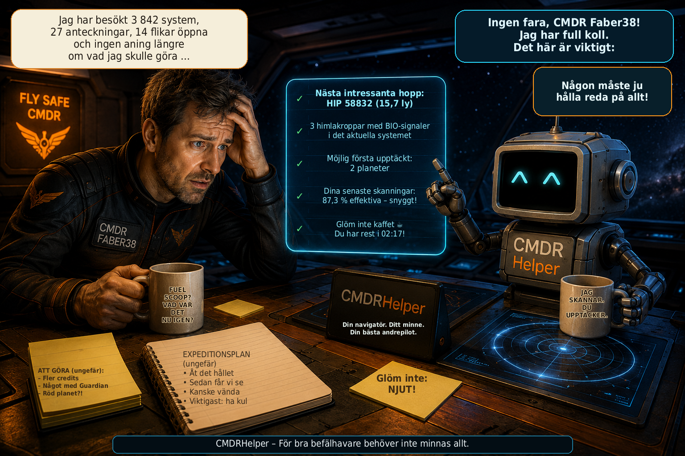

# CMDRHelper

[🇩🇪 Deutsch](README_DE.md) \| [🇬🇧 English](README.md) \| [🇫🇷
Français](README_FR.md) \| [🇮🇹 Italiano](README_IT.md) \| [🇳🇴
Norsk](README_NO.md) \| [🇸🇪 Svenska](README_SV.md) \| [🇫🇮
Suomi](README_FI.md) \| [🇵🇱 Polski](README_PL.md) \| [🇳🇱
Nederlands](README_NL.md) \| [🇪🇸 Español](README_ES.md) \| [🇹🇷
Türkçe](README_TR.md) \| [🇬🇷 Ελληνικά](README_EL.md)



**Personlig följeslagare för Elite Dangerous – utforskning, navigation och befälhavardata i en överblick**

CMDRHelper är ett fristående skrivbordsprogram som analyserar de lokala Elite Dangerous-journalerna och använder planetära positionsdata från `Status.json`. Det hjälper dig att hitta intressanta himlakroppar, återvända till sparade platser och följa dina resor och fynd. Personliga data bevaras efter omstart och hålls åtskilda per befälhavare.

## 🚀 Snabbstart

Ladda ned **ZIP-filen för den senaste CMDRHelper-versionen** (`CMDRHelper_v*.zip`) från [GitHub Releases](https://github.com/Faber38/CMDRHelper/releases/latest) under **Assets** och packa upp hela ZIP-filen i en egen mapp.

### Windows

1. Kör **`install.bat` en gång** i den uppackade mappen. Den skapar den lokala Python-miljön (`venv`) och installerar beroenden. Om lämplig Python saknas kan den installeras automatiskt via `winget` efter ditt godkännande; `winget` måste vara tillgängligt.
2. Starta efter installationen med **`start.bat`**. Använd även denna fil vid senare starter.

### Linux

Python **3.10 eller senare** med motsvarande `venv`-modul måste redan vara installerat. Öppna en terminal i den uppackade mappen och kör en gång:

```bash
bash install.sh
```

Skriptet skapar den lokala miljön och installerar beroenden; det installerar inga systempaket. Starta sedan CMDRHelper, även vid senare starter, med **`bash start.sh`**.

### Första starten och uppdateringar

Journalmappen för Elite Dangerous hittas automatiskt när det är möjligt. Om den saknas eller är felaktig väljer du den i **Inställningar**.

CMDRHelper söker efter uppdateringar vid start och har en inbyggd uppdateringsfunktion. Bekräfta en erbjuden uppdatering i programmet; den uppdaterar programmet och beroendena och startar om CMDRHelper. Efter den första installationen använder du normalt bara `start.bat` (Windows) eller `bash start.sh` (Linux). Du behöver inte köra `install.bat` eller `install.sh` manuellt igen för vanliga uppdateringar.

## CMDRHelper v3.9.21

- Skärmbildshantering per befälhavare för Steam och Heroic, med tillförlitlig koppling och förbättrade filnamn.
- Tydligare färger för uppdragsstatus och automatisk markering av nådda uppdragsmål med en kort blinkeffekt.
- Tillförlitligare åtskillnad mellan last i SRV, skepp och carrier, med förbättrad hantering av Cargo- och MiningRefined-händelser.
- Upp till tio ögonblicksbilder av lasten per fordons- och källkontext, även när gruvvyn är stängd.
- Skeppets senast kända last förblir synlig som möjligen inaktuell och räknas inte in i totalsummor.
- Guldgul redigeringspenna för carrier och enhetliga handpekare för klickbara element.

## CMDRHelper v3.9.20

- NYTT: Visa sparade marknader oberoende av din nuvarande position.
- NYTT: Fullständiga varulistor med köp- och säljpriser samt utbud och efterfrågan i ton.
- NYTT: Filtrera marknader efter avstånd, landningsplattformens storlek och uppgifternas ålder.
- FÖRBÄTTRAT: Sortera marknader och varor efter namn, priser och mängder.
- FÖRBÄTTRAT: Tydligare verktygsfält i PP2-dagskrönikan.
- ÅTGÄRDAT: Marknader på Stronghold Carriers identifieras och sparas korrekt.

## CMDRHelper v3.9.19

- Gruvkolumnen ”Eget försäljningspris / t” visar den valda befälhavarens senaste registrerade försäljning. Även ett nyare lägre pris ersätter det äldre priset.
- Försäljningens verktygstips visar datum och tid, station, system, mängd och pris per ton när uppgifterna är kända. Marknadserbjudanden och inköpspriser räknas inte som egna försäljningar.
- Rena lagerändringar under gruvdrift startar ingen prisarbetare och skriver inte om oförändrade prisceller. MarketSell uppdaterar priserna; byte av befälhavare tar omedelbart bort tidigare personliga priser.
- PP2-dagskrönikan har ett kompakt systemfilter med flerval, ”Alla system” och ”Okänt system”. Tillsammans med tidsfiltret bestämmer det synliga händelser och meriter i filtret.
- Systemfiltret återställs vid byte av dag eller befälhavare och behåller urvalet när nya händelser tillkommer samma dag. Losskoppling och dockning stöds; menyn använder befintliga dagsdata utan en ny SQL-fråga för dagen.
- Databasschemat förblir 23. Riktade tester med syntetiska data och Qt offscreen omfattar tolv språk och mörkt/ljust läge. Ingen fullständig regression eller testning direkt i Windows.

## CMDRHelper v3.9.18

- Underhålls- och tillförlitlighetsuppdatering för EDSM-journaluppladdning; inga nya funktioner.
- EDSM-indikatorn överst och dess verktygstips bedömer bara uppladdningar: grönt OK, gult Väntar, rött Fel, grått Okänd eller Av. Nedladdningar, cacheträffar och anslutningstester ändrar inte färgen.
- HTTP-svar, övergripande svar och enskilda svar kontrolleras tillsammans. Saknade eller okända bekräftelser frigör ingen kontrollpunkt; 500/501 räknas inte som bekräftad lagring.
- 100–103 räknas som registreringsbevis; 104/304 kan avsluta händelser men ger inte ensamma en grön indikator. Bara ett entydigt slutfört prefix flyttar kontrollpunkten framåt.
- Ändpunkter, batchstorlek, tidsgränser, intervall för nya försök, uppladdningsordning och befälhavare-/FID-koppling är oförändrade. Originaljournaler är oförändrade; databasschemat är fortfarande 23.
- Bekräftade händelser efter en lucka kan skickas igen. Avvisade händelser hoppas inte över automatiskt; efter omstart börjar indikatorn utan bevis på framgång. Ingen inbyggd Windows-validering.

## CMDRHelper v3.9.17

- Extern systemsökning i Explorer ovanför aktuellt system: Retur eller knappen startar asynkron namnuppslagning via Spansh. Den befintliga systemkartan visar stjärnor, planeter, månar och anläggningar i ett separat storleksändringsbart fönster utan tvingad förgrund; klicka på en himlakropp för detaljer.
- Spansh-data, entydigt identifierade lokala EDSM-cachar och krönikedata från alla befälhavare kombineras med källor och konflikter. Egna skannings- och kartläggningsbevis förblir kopplade till rätt befälhavare; externa data räknas inte som egna upptäckter. Krönikan läses endast.
- Planeter som går att landa på markeras tydligt. Detaljer visar typ, gravitation, atmosfär och kända material; obekräftade Spansh-andelar visas inte som procent. Spansh/EDSM garanterar inga specifika Rhino-gruvplatser eller deras resurser.
- Avslutade Explorer-sökarbetare och deras signalobjekt frigörs; inaktuella resultat ignoreras. Upprepade sökningar samlar inte på sig QRunnable-objekt.
- PP2-dagskrönikan återanvänder oförändrade dagsdata och tabeller. Nya meriter och senare rättelser uppdaterar visningen; dags- och tidsfilter, befälhavarbyte och frikopplad krönika stöds fortfarande.
- Externa fönster visar ögonblicksbilder. EDSM-cachar utan entydig systemidentitet slås inte samman. Databasschemat är fortsatt 23; information på tolv språk. Testning direkt i Windows återstår.

## CMDRHelper v3.9.16

- PP2-avsnitten för aktuellt system, aktiviteter och artiklar ombord kan fällas ihop var för sig: stängda vid första användningen, därefter med sparat tillstånd. Din makt och dagskrönikan förblir synliga.
- En oklar aktivitetstyp visar ett kort allmänt tips om att genskjuta andra befälhavare, utan att hävda bekräftad lokal tillgänglighet. Entydiga aktiviteter, Ethos-markörer och säkerhetskontroller behålls.
- Främmande makter som kontrollerar det aktuella systemet får ett befintligt porträtt på 42 × 56 pixlar bredvid namnet. Din egen makt får inget extra porträtt.
- Kontrollgrafiken med fyra steg för kontrollerade system är ungefär 25 % lägre, inklusive texter och teckenförklaring. Markörpositioner, röd/blå färgning och CP-beräkningar är oförändrade.

## CMDRHelper v3.9.15

- Mer kompakta PP2-konfliktkort för obesatta system: porträtt, staplar och avstånd är ungefär 25 % mindre; texten minskas från 12 till 10 pixlar för att behålla läsbarheten.
- Med minst tre deltagande makter och tillräcklig fönsterbredd visas de två ledande makterna till vänster och alla övriga till höger. Smala fönster och högst två makter behåller en enda kolumn.
- Det befintliga systemkortet använder bredden under handlingsråd och artiklar ombord utan att täcka dem. Båda konfliktkolumnerna börjar på samma höjd och tar mindre vertikalt utrymme; alla deltagare förblir synliga.

## CMDRHelper v3.9.14

- Omarbetad PP2-konfliktvy för obesatta system: större befintliga maktporträtt, maktnamn och kontrollpoäng i en anpassningsbar layout; sortering efter framsteg och befintliga maktfärger behålls.
- Kontrollpoäng i konflikter som en empiriskt stödd uppskattning: CP ≈ ConflictProgress × 120000. Stapeln använder en antagen skala från 0 till 180000 CP, begränsad till 100 %; saknade värden förblir okända.
- Streckade konfliktmarkeringar vid 36000 CP (20 %) och 120000 CP (66,67 %), med symboler och översatta verktygstips. Gränserna och skalan är inte bekräftade officiella spelkonstanter; en passerad markering ändrar inte systemstatus.
- Din egen makt visas separat med ”Ingen närvaro” när den saknas, utan dubbla deltagare. Namnvarianter för samma makt slås samman.
- Odyssey-uppdrag: genererade detaljtexter följer senare måländringar. Uttryckliga ursprungliga mål i MissionRedirected sparas separat per befälhavare; det nya målet förblir navigationsmålet. Saknade platser eller planeter gissas inte.
- Huvudfönstret sparar storlek, position och maximerat tillstånd och återställer dem vid omstart. Ogiltig sparad geometri använder standardvärden; positioner som inte längre syns korrigeras.

## CMDRHelper v3.9.13

- PP2-systemkontroll: fyra färgade områden för Ej ockuperat, Exploaterat, Befäst och Fäste; vit triangel för systemstatus och gul triangel för den aktuella cykelns framsteg.
- Markörernas positioner är uttryckligen ungefärliga, ingen bekräftad Frontier-beräkning. Intervallet färgas rött när vitt står till höger om gult och blått när vitt står till vänster. Förstärkning och försvagning visas som oförändrade journalvärden i CP.
- Egen PP2-konfliktvy för obesatta system: makter sorterade efter konfliktframsteg, med relativa staplar och befintliga porträtt. Bekräftade färger för Aisling Duval och Nakato Kaine, annars neutral visning; saknade värden förblir okända och absoluta konflikt-CP är inte tillgängliga.
- Alla tolv befintliga maktporträtt används; A. Lavigny-Duval pekar på Arissa Lavigny-Duval. Befintliga reservvisningar behålls.
- Uppdrag: sortera alla sju kolumner stigande och fallande, belöningar numeriskt och tidsfrister kronologiskt; sorteringen sparas via QSettings.
- Uppdragsdetaljer förblir kopplade till rätt uppdrag efter sortering och uppdatering; byte av befälhavare rensar föregående val. Nya PP2-texter finns på alla tolv språk.

## CMDRHelper v3.9.12

- Explorer-fönster: tillförlitlig uppdatering och värdesortering på alla tolv språk.
- Koppla loss och docka PP2-händelseloggen: fritt ändringsbar fönsterstorlek med sparad storlek och position; filtren behålls. Meritsumma på en rad för dagens visade händelser och valt tidsfilter, inklusive ej tilldelade meriter.
- Styr följning av aktiv befälhavare direkt i översikten; inställningen synkroniseras med CMDR-vyn och sparas mellan omstarter. Vid manuellt befälhavarval förklarar en gul text att automatiskt val är avstängt; den blinkar i tio sekunder och förblir sedan synlig.
- Favoriter: kopiera systemnamn med kopieringsikonen utan att välja eller navigera; en grön bock bekräftar kopieringen i två sekunder.
- Långa aktiva journaler: återanvänd verifierade resultat, undvik dubbel rekonstruktion av tillståndet och minska pauser i gränssnittet.
- Förloppsfönstret vid start är återställt: gemensam visning för aktiverade journalkällor och korrekt felrapportering när den första importen misslyckas.

## CMDRHelper v3.9.11

- Windows: automatisk följning vid bekräftad koppling mellan Elite-process, aktuell journal och befälhavarens FID; stöd för äldre följningsinställningar.
- Handelsassistent: rekommendationer använder marknadsobservatören för vald journalkälla, utan stationskontext från andra källor.
- PP2-krönika: detaljer på en rad med ” | ”, uteslutningstecken vid platsbrist och fullständiga verktygstips.
- Icke-modala extrafönster ligger alltid överst; huvudfönster och modala dialoger är oförändrade.

## CMDRHelper v3.9.10

- Journalmappar: flera källor med Steam-/Heroic-identifiering, redigering, kryssrutor för övervakning och separat statistik.
- Commanders: FID-verifierad tilldelning, sparat val och valfri automatisk följning av en entydigt identifierad spelinstans på Linux.
- Powerplay 2.0: valfritt klockslagsfilter, kompakta transportrader och förbättrad koppling av skeppsskanningar för +1 till +100 merits och nya fullständiga skanningar av tidigare sedda mål.
- Extrafönster förblir öppna oberoende när huvudfönstret minimeras och stängs när hjälpprogrammet avslutas.
- EDSM och Inara: separata EDSM-reglage för sändning och mottagning, uppladdningspositioner per källa, tillförlitliga bekräftelser och förbättrad hantering av nya försök.
- Tillförlitligare journalbehandling med transaktionella läspositioner och identitetskontroller; integritetsvänlig Odyssey-visningsdiagnostik i diagnospaketet.

## CMDRHelper v3.9.9

- Flytta planetnavigeringen till ett separat fönster och tillbaka med samma mål och realtidsdata.
- Öppna favoritbilder i originalupplösning, zooma med mushjulet och dra för att flytta bilden.
- Favorittitlar visas i Elite-gult (#FFCC33), medan markering och övriga textrader behålls.
- Exportera alla eller valda favoriter med bilder och koordinater i det befintliga kompatibla ZIP/JSON-formatet.
- Tydligare navigering med kompassymbol och ”Till planetnavigering”.

## CMDRHelper v3.9.8

- Favoriter och planetnavigering är integrerade direkt i huvudgränssnittet som två flikar.
- Navigering öppnar en gemensam huvudsida utan extra favorit- eller navigeringsfönster.
- När ingen snabbtangent är inställd visas snabbfavorittipset i Elite-gult, blinkar mjukt tre gånger och förklarar inställningen under Inställningar.
- Den inbyggda hjälpen beskriver de nya flikarna och menyvägarna på alla tolv språk.

## CMDRHelper v3.9.6.7

- Förbättrad koppling av Powerplay-meriter till skeppsskanningar och varuförsäljning.
- Skeppsskanningar stöder +5 och +10 meriter; vanlig varuförsäljning kan få flera tilldelningar inom fyra sekunder (≈). Konkurrerande eller tvetydiga händelser förblir oklara (?).
- Lastvisningarna förblir synliga när de är aktiverade, utan att döljas vid inaktivitet; last- och drönarvärden uppdateras utan att visningarna öppnas på nytt.
- Ny utfällbar huvudmeny Navigering med Favoriter och Planetnavigering ersätter de tidigare knapparna i Explorer.
- Den inbyggda hjälpen beskriver de nya menysökvägarna på alla tolv språk som stöds.

## CMDRHelper v3.9.6.6

- Förbättrad koppling av Powerplay-meriter till varuförsäljningar i följd.

## CMDRHelper v3.9.6.5

- Robustare Windows-start: Icke-kritiska bakgrundsfel visas som delfel och huvudfönstret kan fortfarande användas.
- Begränsade återförsök för landningsplatsdata och journaluppdatering, förbättrad kartografireparation samt säkrare journalindexering och avslutning.
- Mer informativa tekniska felkategorier i diagnostiken, samtidigt som personliga uppgifter förblir anonymiserade.
- Lugnare lastutrymmesvisning vid gruvdrift genom återanvändning av fönster och tabellrader; automatisk döljning först 15 sekunder efter senaste lagerändringen.
- Enhetliga lokaliserade varunamn utan ändringar av lagerberäkningen eller den separata drönarvisningen.
- PP2-dagskrönika: Även vanliga varuförsäljningar kan försiktigt kopplas till meritpoäng (≈); tvetydiga fall behåller ?, och totalsumma och rangberäkning är oförändrade.

## CMDRHelper v3.9.5

- Ny Odyssey-bedömning: 192 av 223 föremål har rang A–D; 31 är fortfarande markerade med ? i väntan på kontroll.
- Färgad rangkolumn med verktygstips och sparad sortering A–D eller D–A; personliga rensningsmarkeringar förblir oberoende.
- Korrigerade hangarfartygsrutter: hela den bekräftade använda kapaciteten skickas till Spansh, med tanktritium och lagrat tritium åtskilda.
- CarrierStats hämtar kapacitet och tankuppgifter med kontroll av identitet, session och aktualitet; lagrat tritium anges fortfarande manuellt.
- Tydligare inmatningshjälp, markerade ogiltiga fält och tre orange blinkningar vid saknad bekräftelse, i båda teman och tolv språk.
- Extra skydd mot inaktuella bekräftelser och sena ruttresultat efter kontextbyten; CTSVision-export förblir kompatibel.

## CMDRHelper v3.9.4

- Förbättrad ruttplanerare med stöd för 7A SCO FSD och korrekt hantering av modifieringar, Guardian-boosters, last och reservbränsle.
- Ny skeppsdatasassistent förklarar, kompletterar och sparar saknade värden per skepp; bekräftade automatiska data har företräde.
- Precisare tidskoppling mellan Powerplay-leveranser och meritmeddelanden inom tre sekunder när sammanhanget är entydigt.
- Gruvdrifts-, Odyssey-, material- och flottvyer undviker onödig ombyggnad och återanvänder befintliga visningselement.
- Ny städhjälp för Odyssey med 81 standardkandidater, personligt urval bland 223 föremål, färgmarkering och sparad sortering.
- Förbättrad indatavalidering, felmeddelanden och laddningsindikatorer samt uppdaterade texter på alla tolv språk.

## CMDRHelper v3.9.3

- Tre nya stationsbilder, förbättrad typkoppling och korrigerade markeringar av planetstationer.
- Bekräftade Interstellar Factors visas i turkos bredvid stationsnamnet.
- Bildgalleriet laddas i bakgrunden med en holografisk laddningsskanner och skydd mot upprepade klick.
- Powerplay-rangframsteg visas i grönt eller orange; prioritering och lagring av meriter har korrigerats.
- Merittilldelningar kan kopplas tidsmässigt till försäljning av sällsynta varor inom två sekunder när sammanhanget är entydigt.
- Uppdaterat porträtt av Nakato Kaine och reviderade texter på alla tolv språk.

## CMDRHelper v3.9.2

- Ny sökning efter sällsynta varor i närheten, med sparande av destinationer i handelslistan.
- Förbättrad visning av materialförråd när speldata är motstridiga.
- Utökad och förtydligad hjälp för Powerplay 2.0.
- Omfattande förbättringar av översättningarna.
- Ytterligare stabilitetsförbättringar.

## CMDRHelper v3.9.1

- Powerplay-aktiviteterna visar nu de Ethos-aktiviteter som Elite har markerat.
- Powerplay-hjälpen har uppdaterats i enlighet med detta.
- Lagt till tack till befälhavarna och spelargruppen EOT för deras stöd.
- Små förbättringar och rättelser.

## CMDRHelper v3.9.0

- Sällsynta varor har integrerats i handelsassistenten.
- Ursprungsstationer för sällsynta varor identifieras och söks upp automatiskt vid behov.
- Förbättrad lastidentifiering med direkt val av varor ombord för försäljningssökning.
- Sök efter lämpliga försäljningsstationer för flera varor ombord samtidigt.
- Kraftigt utökad hjälp för Powerplay 2.0.
- Ytterligare förbättringar av stabilitet och tillförlitlighet.

## CMDRHelper v3.8.3

- Åtgärdat ett fel som hindrade uppdatering av nya lokala marknadsdata efter att vissa uppdrag accepterats.
- Förbättrad stabilitet för bevakningen av lokala marknader.

## CMDRHelper v3.8.2

- Felkorrigeringar och förbättringar i handelsassistenten.
- Tillförlitligare identifiering av lastrum, stationer och lokala marknader.
- Förbättrad information om landningsplattor och visning av stationer.
- Snabbare bearbetning av stations- och landningsplattedata.
- Små förbättringar av användbarhet och statusvisning.

## CMDRHelper v3.8.0

- Ny handelsflik ”Sälj här”: Hitta billiga inköpsställen för varor som kan säljas med vinst på den aktuella marknaden.
- Utnyttja både ut- och återresan: Sök varor för utresan från en sparad inköpsstation och köp sedan den planerade returvaran där.
- Mer information om inköpsställen: Se utbud och efterfrågan separat samt kända himlakroppar för ytstationer.
- Handelssökning med enbart lokala data omfattar nu även köp och försäljning och använder kända landningsplattors storlek bättre.
- Tillförlitligare lastrumsavläsning: Bekräftade mängder behålls så länge sammanhanget är giltigt och oförändrat; skepp, SRV och läge till fots skiljs åt bättre.
- Stationsmarknaden känns fortfarande igen efter ombordstigning: Återgång till det egna skeppet kräver ingen ny dockning.

## CMDRHelper v3.7.8

- Buggfixar i handelsassistenten.
- Förbättrad avläsning och uppdatering av lastutrymmet.
- Åtgärdade fel i materiallagret vid kapacitetsgränsen.
- Allmänna förbättringar av stabilitet och tillförlitlighet.

## Intern version 3.7.5

Intern version för tester i spelet; inte publicerad.

- Explorer: EDSM-status och normalisering av stjärnklasser, fortsatt komplettering av saknade himlakroppar, första fotavtryck över sessionsgränser med korrigerad sammanslagning, automatisk bredd och linjär layout för värdelistan. Kopieringsikon vid senaste system; uppdaterad hjälp, översättningar och tester.
- [Detaljerade versionsanteckningar (tyska)](docs/release-3.7.5.md)

## Nytt i version 3.7.0

- Ny huvuddel Handel: försäljning och inköp kombinerar egna observerade marknader med Spansh-erbjudanden. Om gemenskapens sökning misslyckas förblir passande lokala träffar användbara och markeras som ofullständiga.
- När varumarknaden i Elite öppnas registreras stationsmarknaden automatiskt. Egna observationer finns kvar efter omstart, gäller i strikt mindre än 24 timmar och ersätter äldre erbjudanden från samma marknad.
- Rekommendationer använder din aktuella observerade inköpsmarknad, ledigt lastutrymme, tillgång och efterfrågan. Minsta marginal, möjlig mängd och möjlig vinst hjälper vid valet; mål kan begränsas till egna marknader.
- Handel visar förlopp, kopierbar diagnostik och marknadsstatus. En sparad handelsflygning behåller varan och målet; målsystemets namn kan kopieras.
- Den fullständiga systemöversikten kan anpassas till fönstret en gång när den öppnas. Alternativet är på som standard och sparas; manuell zoom är fortfarande möjlig.
- Hjälpen har granskats och utökats i tolv ämnen och tolv språk, med bättre översättningar och stor text. Gruvvarulager på carrier bevaras vid korta avslutningsjournaler.

## Nytt i version 3.6.2

- Stridsobligationer under ”Uppdrag och belöningar”, med belopp per fraktion, totalsumma och lokal återställning.
- Stridsobligationer som registreras live sparas per befälhavare över omstarter; verifierade journalankare förhindrar dubbelräkning.
- Premier, stridsobligationer och Odyssey delar läsningen av den aktiva journalen med separata bekräftelser.
- En entydig inlösen tömmer det observerade saldot för den namngivna fraktionen; äldre innehav och inlösenbeloppet påverkar inte andra fraktioner.
- Död tar bort observerade, ej inlösta stridsobligationer; återupplivning och förlust av SRV orsakar ingen extra återställning.
- Premier och stridsobligationer hålls åtskilda. Registreringsluckor och lagringsfel visas tydligt.

## Nytt i version 3.6.1

- Aktuella prispengar under Uppdrag, sparade varaktigt och separat för varje befälhavare.
- Uppdrag från rymdmöten och budbärare visas innan ett slutgiltigt MissionID finns.
- Erbjudanden från möten finns kvar efter omstart och blir vanliga uppdrag efter entydig bekräftelse, utan dubbletter.
- Förbättrad matchning av vara, mängd, destination, belöning och tid; tvetydiga erbjudanden matchas inte genom gissningar. Obekräftade erbjudanden löper ut efter 24 timmar.
- Befälhavare → Uppdrag visar aktuella uppdrag. Nya avslut bygger inte längre upp ett växande uppdragsarkiv; befintliga historiska rader bevaras.
- Hanteringen av möten är åter helt ansluten; gamla händelser skriver inte över nyare uppdragsstatus. Motstridig återställning av uppdrag har tagits bort.

## Nytt i version 3.6

- Stationer och anläggningar på systemkartan samt en egen stationsflik med sökning, filter och sortering.
- Stationsbilder, bildvisare och detaljer om kända tjänster, landningsplattor, källor och tidsstämplar.
- Valfri Spansh-stationsinformation under Inställningar → Onlinetjänster, avstängd som standard. Efter en lyckad hämtning blockeras fler manuella förfrågningar samma lokala dag. Utan Spansh visas en förklaring av journaluppgifternas begränsningar.
- Personliga skepps- och carrierbilder, typ-/standardbilder och bildvisare. Ta bort skepp ur flottan eller återställ dem genom att läsa in alla skepp igen; sålda skepp identifieras säkrare.
- Förbättrad karta, värdelista med färgad kartläggningsstatus, Cargo HUD och navigering. Lägre bakgrundsbelastning i Linux samt för skärmbilder, galleri och Explorer.
- Åtgärdat: harmlösa korta Elite-journaler avbryter inte längre carrierns gruvlager. Okända eller osäkra uppgifter förblir tydligt markerade.

## Nytt i version 3.5

- Snabbare krönika och gränssnitt; BIO- och kartografibearbetning i bakgrunden.
- Odyssey visar skåp, ryggsäck, personlig beläggning per kategori och beräknat hangarfartygslager.
- Inställning via ! skiljer tydligt mellan bekräftat 0 och okänt —.
- Hangarfartygets lager visas separat från utrymme reserverat för bartenderns köporder.
- Tillförlitligare Mining-lager med säkrare Cargo-bilder, upphämtning av överföringar och kontrollerad lagring.
- Felaktig migreringsbegäran vid nyinstallation rättad; kopiering i krönikan och dolda vyer förbättrade.

Skåp och ryggsäck använder validerade aktuella ShipLocker/Backpack-data. Varor, Material och Data visar var sin personliga kapacitet på 1000. Totalt summerar skåp + ryggsäck + hangarfartyg endast med kända, samstämmiga värden. Köp, försäljning och byten skiljs från privata överföringar. Efter omstart rekonstrueras platsen och en ny personlig bas sätts; missade Odyssey-överföringar hittas inte på. Fiktivt exempel: 500 enheter + 100 platser reserverade för köp = 600 / 1000. De 100 är inte material. Gamla eller osäkra marknadsdata ger ingen påstådd aktuell beläggning.

### Ställ in hangarfartygets lager

CMDRHelper kan automatiskt uppdatera ditt Fleet Carriers privata Odyssey-lager. Först behövs ett bekräftat startvärde.

Öppna inventarieöverföringen på ditt eget hangarfartyg och jämför Varor, Material och Data.

Dubbelklicka i kolumnen Hangarfartyg och ange aktuell mängd för VARJE position. Bekräfta även ALLA tomma positioner uttryckligen med 0.

— = ännu inte bekräftat / okänt
0 = uttryckligen bekräftat tomt lager

Efter fullständig inställning följer CMDRHelper överföringar mellan ditt personliga skåp och hangarfartyget automatiskt när du tydligt befinner dig på ditt eget hangarfartyg. Personliga ändringar på andra platser ändrar inte dess lager.

Du kan korrigera eller bekräfta varje värde igen med dubbelklick.

Öppna köporder hos bartendern reserverar också lagerutrymme. Beläggningen i spelet kan överstiga summan av befintliga material. Bartenderhandel, särskilt av andra spelare, kan ändra det verkliga lagret. Kontrollera och bekräfta det beräknade lagret igen vid behov.

Mining håller Skepp, SRV och Hangarfartyg åtskilda. Explicita CargoTransfer-händelser hämtas upp exakt en gång över verifierade journalgränser; Cargo.json och sparade kontrollpunkter valideras striktare. Detta är inte Odysseys differenslogik. Andra spelares handel kan kräva ny bekräftelse. Nya databaser får Parent-Hierarchy-markören efter initiering, så första importen inte utlöser felaktig historisk migrering. Gamla databaser utan markör kräver fortfarande migrering med Elite stängt. ⧉ kopierar krönikenamn och ✓ bekräftar kort. Uppdrag laddas mer riktat och dolda vyer byggs inte om i onödan.

## Nytt i version 3.4.6

- Stabilare arkivimport med stora journalsamlingar.
- Ett mer responsivt gränssnitt under långvarig databehandling.
- Förbättrad inhämtning av nya och utökade journaler efter import.
- Snabbare arkivbearbetning och uppdatering av gruvdata.
- Klicka på systemnamnet i krönikans öppna systemvy för att kopiera det.
- Korrigerad visning av flikar i mörkt läge på Windows.

## Nytt i version 3.4.5

- Stabilare arkivimport med stora journalsamlingar.
- Ett mer responsivt gränssnitt under långvarig databehandling.
- Förbättrad inhämtning av nya och utökade journaler efter import.
- Snabbare arkivbearbetning och uppdatering av gruvdata.
- Klicka på systemnamnet i krönikans öppna systemvy för att kopiera det.
- Ytterligare prestanda- och stabilitetsförbättringar.
- Korrigerad visning av flikar i mörkt läge på Windows.

## Nytt i version 3.4.4 – Hotfix

- Åtgärdat fel med mycket stora uppdrags-ID:n så att uppdrag sparas tillförlitligt.
- Efter ett lagringsfel försöker journalbearbetningen igen med allt längre pauser, utan att hoppa över poster.
- Förbättrad uppstart när ingen aktiv befälhavare har identifierats ännu.
- Mer användbar teknisk diagnostik för dessa fel, utan att logga faktiska uppdrags-ID:n.

## Nytt i version 3.4.3

- Utökade favoriter: avståndsfilter och portabel ZIP-export/import inklusive bilder.
- Sortera Explorer-tabeller och spara sortering och kolumnbredder separat för varje tabell.
- Gruvdrift visar SRV, skepp, carrier och totalt separat; lagerfiltret tar hänsyn till alla tre lagren.
- Diagnostikpaket och integritetsvänliga roterande loggar för support, utan automatisk överföring.
- Säker databasuppgradering direkt från äldre versioner; migreringskopior behålls under hela versionen som skapade dem.
- Förbättrad användning, uppdaterad hjälp och tydligt klickbara punkter på krönikekartan.

Avståndsfiltret är avstängt från början (standard 500 ljusår), använder lokala systemkoordinater och uppdateras vid systembyte. Favoritexporten innehåller favorites.json och tillgängliga bilder; dubbletter kan hoppas över, ersättas eller importeras som nya. Värdelistan och BIO/GEO/GRUVDRIFT-tabellerna stöder naturlig, numerisk och semantisk sortering. Version 3.4.1 behöver inte installeras först.

## Nytt i version 3.4.1

- Rättar äldre sparade systemhierarkier
- Förbättrad visning av planeter, månar och flerstjärniga system
- Säker databasuppdatering med automatisk säkerhetskopia och återställning vid fel
- Elites journalfiler förblir oförändrade
- Ytterligare stabilitets- och visningsförbättringar

Databasuppdateringen rättar äldre sparade relationer mellan stjärnor, planeter och månar. Journalerna läses endast. Stäng Elite Dangerous först och gör historiska journaler tillgängliga om möjligt. Hela CMDRHelper-databasen säkerhetskopieras i förväg; vid fel ångras ändringarna och säkerhetskopian återställs vid behov. Kopian behålls som säkerhet. Avbryt låter dig skjuta upp uppdateringen.

## Nytt i version 3.4 – Mining och lager

- Ny Mining-del med varor, referenspriser och värdeklasser.
- Skepps-/SRV-lager och manuellt bekräftat carrierlager med automatisk spårning av överföringar.
- Kombinerbar sökning och filter för planetutvinning och asteroider/ringar.
- ABBAU ×N öppnar rätt Mining-översikt direkt.
- Korrekta kartografivärden vid sessionsbyte.
- Förbättrad hjälp, tabellutseende och användbarhet.

En gemensam tabell innehåller 57 gruvvaror med ursprung Surface, Asteroid eller Both. Kända referenspriser och härledda värdeklasser är fasta riktvärden, inte marknadsdata i realtid.

Verifierad skepps-/SRV-last; dubbelklicka för att bekräfta, korrigera eller återställa carrierlagret till okänt. Endast entydiga CargoTransfer-händelser till/från din egen carrier följs från ett bekräftat startlager. Totalen visas endast när båda mängderna är kända; okänt förblir —.

Filter för positivt lager, värdeklass och ursprung kan kombineras; tillstånd, sortering och kolumnbredder sparas. ABBAU ×N väljer automatiskt planetutvinning. Manuell lastuppdatering har statusanimation och bevarar carriervärden.

Förbättrad Mining-tabell, carrierverktygstips och versionsoberoende integrerad Mining-hjälp. Handpekare på befintliga interaktiva himlakroppar och kontroller i systemkartan. A-6-a-platshållarfixen bevarar korrekta kartografivärden mellan sessioner.

## Nytt i version 3.3.1 – Felrättningar

- Slutförd DSS-kartläggning identifieras nu tillförlitligt i realtid.
- Kartläggningen bevaras även om motsvarande skanning visas senare i den aktuella journalen.
- Din kartläggningsstatus, kartläggningstid och sondeffektivitet sparas tillförlitligt.
- Arkivimport ersätter inte längre befintliga skannings- och kartläggningsvärden med felaktiga nollvärden.
- Berörda himlakroppar med fullständiga data får korrekta visningsvärden igen när de läses in eller uppdateras.
- Kartläggningsuppskattningar för Live inkluderar nu rätt bonusar; krediternas decimaler kapas först i slutet.
- Korrigeringsfaktorer från försäljningar ändrar inte längre vanliga utforskningsvärden.
- Fler regressionstester täcker kartläggning mellan sessioner och beständig lagring av kartläggningsdata.

## Nytt i version 3.3

- Ny systemanalys baserad på din personliga utforskningserfarenhet.
- Spelläget Öppet / Solo / Privat grupp direkt i översikten.
- Kopiera systemnamn från senaste system med ett klick.
- Tydligare erfarenhetsdata och mer lättförståelig analys.
- Tillförlitligare import av journalarkiv när journalfiler utökas senare.

Det tidigare hopptipset heter nu Analys, med Systemanalys och befintliga erfarenhetsdata. Systemanalysen jämför ett mål med din personliga historik: Masskoden ger grunduppskattningen, medan region och familj förfinar den försiktigt. Potentialindex 100 motsvarar ditt personliga historiska genomsnitt av dämpad utforskningspotential, inte en sannolikhet i procent. Dataunderlag och tillförlitlighet hålls åtskilda från bedömningen; slutnumret påverkar inte poängen och BIO är för närvarande endast informativt.

## Nytt i v3.2 jämfört med v3.1

- Materialhantering för engineering: alla 146 material i Raw, Manufactured och Encoded, med grader, kapacitet och undantag. Aktuellt lager per commander, sökning, filter, fem diskreta radbakgrunder och sparade kolumnbredder och ordning ger överblick. Okänt lager skiljs från noll.

- Odyssey-inventarium: den fjärde materialfliken innehåller 223 katalogidentiteter för varor, komponenter, data och förbrukningsvaror. Skeppsförråd, ryggsäck och tillförlitlig totalsumma hålls isär; uppdragsstaplar, uppdragsstatus och engineering-användning visas. Positiva antal visas i guld. Namn utan översättning visas på engelska.

- Sökning efter materialhandlare (Hitta materialhandlare → Öppna ruttplaneraren): på begäran söker Spansh separat efter Raw, Manufactured och Encoded från commanderns aktuella system. Carriers utesluts och stationsdetaljer kontrolleras. Avståndet i ly är direkt mellan systemen; gemenskapsdata garanterar inte åtkomst. Överföring till ruttplaneraren anger bara målsystemet och startar ingen rutt. Ingen sökning efter Odyssey-handlare.

- Systemöversikt: den nya Elite-inspirerade vyn ersätter miniatyröversikten i Explorer och Krönika. Stjärnor och planeter bildar huvudstrukturen med månar som grenar nedanför; flerstjärnesystem förblir lättlästa. Zoom, rullning, anpassning till fönstret och klick på himlakroppar ger tillgång till detaljer.

- Kompakta asteroidbälten: kluster grupperas till bälten i översikten och de vanliga systemkartorna i Explorer och Krönika. Alla enskilda klusterdata bevaras.

- Korrigerad kartografi: en skanning efter DSS-kartläggning återställer inte längre osålda utforskningsvärden, kartläggningstid eller effektivitet. Felaktiga poster repareras vid start från tillgängliga journaler med entydig commander-koppling. Saknade källor lämnar reparationen öppen; databasen behöver inte raderas.

- Förbättrad ruttplanerare: starten följer automatiskt det aktuella systemet tills du anger en manuellt; tömning av fältet återställer automatiken. Skepp och carriers använder exakt validerade ID64-adresser utan att välja liknande namn. ”Unable to find route” förklaras som att ingen rutt hittades; kontrollera mål, räckvidd och ruttinställningar.

- Bättre uppdateringsinformation: Ja/Nej-fönstret visar installerad och tillgänglig version samt upp till sex nyheter när en sammanfattning finns. Långa listor kan rullas och åtgärderna förblir tillgängliga. Vyn följer med v3.2; en oförändrad v3.1-klient visar den ännu inte.

## v3.1 (v3.0.3 → v3.1)

- BIO-förloppet är kompakt: 1/3 gult, 2/3 blått och 3/3 grönt; det slutförda tillståndet ”Klart” är också grönt. Under ”visa automatiskt” har GEO en egen sparad omkopplare: enbart BIO, enbart GEO eller båda tillsammans. Manuellt justerade kolumnbredder i den gemensamma Explorer-tabellen BIO / GEO / ABBAU bevaras när fönstret öppnas igen och efter omstart. Sparade kolumnbredder i popupfönster återställs robustare; ogiltiga värden ersätts med säkra standardbredder.

- Upptäckt och kartläggning skiljs åt och gäller ditt skanningstillfälle: ”Redan upptäckt vid din skanning” och ”Redan kartlagd vid din skanning”. Saknade uppgifter förblir Okända. First Discovery- och First Mapping-kandidater gäller bara vid skanningen; ett historiskt Nej bevisar inte att himlakroppen fortfarande är oupptäckt eller okartlagd i dag. Din egen kartläggning bekräftar ingen officiell förstakartläggning. EDSM-kännedom hålls separat.

- ”EDSM-status-HUD” under ”visa automatiskt” är AV som standard. Efter ankomst till ett system visas ett kort meddelande över Elite i cirka 2,5 sekunder. ”EDSM: KÄNT” betyder en giltig EDSM-träff för systemet. ”EDSM: OKÄNT” betyder ett giltigt EDSM-svar utan systemträff. ”EDSM: INGET SVAR” betyder nätverksfel, HTTP-fel, timeout eller ogiltigt svar, aldrig en bekräftad avsaknad av träff. Kännedom i EDSM är inte samma sak som officiell upptäckt i Elite; namn på första upptäckare eller rapportör utlovas inte. Meddelandet fungerar oberoende av navigations- och last-HUD.

- Besökshistoriken tar med Location, FSDJump och CarrierJump även vid löpande journaluppdatering. Flera platshändelser under en sammanhängande vistelse räknas som ett besök: A → A → A räknas en gång. En verklig återkomst bevaras: A → B → C → A räknas som fyra besök.

- Slutförd egen DSS-kartläggning sparar nu tillförlitligt tidpunkten, använda sonder och effektivitetsmålet. Senare skanningar gör inte längre att befintliga uppgifter förloras.

- Lastfönstret anpassar automatiskt höjden efter innehållet. Vid många poster begränsas höjden och tabellen kan rullas; vald bredd och fönsterposition bevaras. Den befintliga omkopplaren ”Lastutrymmets HUD” finns nu under ”visa automatiskt”, utan en extra omkopplare i lastfönstret.

- För befintliga installationer räcker normalt: installera uppdateringen → starta CMDRHelper. Nödvändiga historiska rättelser av BIO-data, besök och DSS-metadata körs automatiskt; databasen säkerhetskopieras före reparationer som skriver data. Reparationerna är versionsstyrda och idempotenta: lyckade revisioner körs inte om fullständigt vid varje start. Rekonstruktion kräver Elite-journaler som finns kvar, är läsbara och entydigt kan kopplas till en commander. Saknade källor hittas inte på eller räknas som framgång; öppna reparationer provas igen vid nästa start. Databasradering, manuella skript och ny import behövs normalt inte.

## Explorer

Explorer visar det aktuella systemet i tre vyer:

- **Systemkarta:** grafisk visning av kända stjärnor, planeter och månar. Klicka på en himlakropp för att öppna detaljerna. ”Visa alla” öppnar systemöversikten.
- **Värdelista:** Värdelistan visar uppskattningar utifrån den sparade skanningen, inte garanterade återstående utbetalningar. Förstabonuser förblir obekräftade. Verktygstips i karta och lista samt kroppsdetaljer använder samma tidsbestämda tillstånd.
- **BIO / GEO / ABBAU:** biologiska och geologiska signaler, planetära gruvplatser och belagda personliga fynd.

Analyserna skiljer rapporterade signaler från faktiska egna fynd. **BIO ×N** är det rapporterade antalet signaler, ingen bekräftelse på fullständigt analyserade arter. **GRUVDRIFT ×N** räknar planetära gruvplatser utan att avslöja deras enskilda råvaruinnehåll. Personligen utvunna handelsvaror, sekundära material insamlade vid gruvdrift och himlakroppens allmänna materialsammansättning hålls åtskilda.

Explorer visar också uppskattade BIO-värden, framsteg i egna analyser och osålda kartografi- och BIO-data. Värdena bygger på tillgänglig journal- och himlakroppsinformation; saknade data visas inte som egna upptäckter. Kompletterande EDSM-data är extern information som ska skiljas från egna fynd.

Himlakroppsdetaljerna innehåller tillgängliga fysikaliska egenskaper, atmosfär, ringar, material och upptäcktsinformation. Avbildningarna använder lämpliga texturer och animationer för vissa särskilda astronomiska objekt. Cargo-området visar känd last och kapacitet för det skepp eller den SRV som används nu; för Rhino är last och personliga gruvfynd fortsatt olika uppgifter.

Välj ”Navigering” till vänster. Flikarna ”★ Favoriter” och ”Planetnavigering” visas till höger, med ”★ Favoriter” vald som standard. ”Navigering → ★ Favoriter” hanterar system, planeter/månar och ytpositioner för aktiv befälhavare; ”Navigering → Planetnavigering” visar planetnavigering i samma huvudområde.

## Planetnavigation

Planetnavigatorn hjälper dig enbart att flyga till en viss **latitud/longitud på en planet eller måne**. För resor mellan stjärnsystem finns den separata ruttplaneraren.

### Ange ett mål och flyg

Välj målets himlakropp eller använd den aktuella, som identifieras automatiskt när det är möjligt. Ange latitud och longitud samt valfritt ett målnamn. Du behöver inte ange tekniska uppgifter som BodyID eller SystemAddress. Även **0,0** är en giltig koordinat.

Så snart Elite levererar giltiga planetära positionsdata för rätt himlakropp aktiveras kompassen automatiskt. Utan motsvarande data visar navigatorn ett vänteläge. Du kan när som helst ange ett nytt koordinatmål på samma himlakropp; det ersätter det föregående målet.

### Visning under inflygningen

| Målavstånd | Visning |
| --- | --- |
| **Mer än 380 km** | Planetglob med den egna positionen som en vit cirkel och målet som en liten punkt. Målet är orange på den synliga sidan och rött på den dolda baksidan. Spelarpositionen ligger fast i visningen; planet och mål visas relativt den. |
| **Till och med 380 km** | Automatisk växling till ett lutande perspektivrutnät med **50-km-avståndsintervall** och målets inritade position för den fortsatta inflygningen. |

Globen och perspektivrutnätet anpassas proportionellt till tillgängligt utrymme. Rulla innehållet när huvudfönstret är smalt eller lågt. Byte av sida eller flik behåller filter och navigeringsmål.

### Förstå navigationsvärdena

- **Målkoordinater:** målets sparade latitud och longitud.
- **Aktuella koordinater:** din senaste giltiga planetära position.
- **Målavstånd / Avstånd över ytan:** beräknat avstånd till målet över klotytan; den stora avståndsvisningen och detaljvärdet visar samma avstånd med olika avrundning.
- **Bäring:** absolut riktning från aktuell position till målet.
- **Heading:** din aktuella orientering som Elite rapporterar.
- **Relativ riktning:** skillnaden mellan heading och bäring, exempelvis ”23° höger”, ”vänster” eller ”rakt fram”.
- **Målkurs:** den absoluta kurs du kan svänga till i Elite-HUD:en. Den motsvarar bäringen och är ingen ytterligare relativ svängvinkel.

Exempel: **Heading 051° → Målkurs 074° = 23° höger**.

Navigationen beror på spelets statusdata; uppdateringar kan komma fördröjt beroende på spelläget. Ytavståndet är ingen terräng- eller vägrutt. Hinder och terränghöjder längs sträckan beaktas inte.

## Navigations-HUD

Till vänster under **visa automatiskt → Navigations-HUD** kan du aktivera en valfri extra visning direkt ovanpå Elite. Vid giltig planetnavigation visar den:

- relativ riktning,
- absolut målkurs,
- avstånd.

HUD:en är transparent, släpper igenom klick och tar inte fokus: den tar varken musklick eller inmatningsfokus från spelet. Utan giltig navigation blir den automatiskt osynlig; sidofältets kryssruta kan vara fortsatt aktiverad. Den vanliga navigatorn fungerar oberoende av HUD:en.

HUD:en har testats i spelet under **Linux/X11** och **Windows 11 med Elite**. I Windows matchas flera bildskärmar genom deras geometri och Elite-fönstrets position, inte genom matchande bildskärmsnamn.

## Favoriter

Välj ”Navigering” till vänster. Flikarna ”★ Favoriter” och ”Planetnavigering” visas till höger, med ”★ Favoriter” vald som standard. ”Navigering → ★ Favoriter” hanterar system, planeter/månar och ytpositioner för aktiv befälhavare; ”Navigering → Planetnavigering” visar planetnavigering i samma huvudområde. Favoriter tillhör den **aktiva befälhavaren**. Byte av befälhavare uppdaterar vyn; befälhavarvalet i krönikan utökar inte favoritlistan.

### Spara tre typer

Den övre åtgärdsraden erbjuder:

| Åtgärd | Sparad favorit |
| --- | --- |
| **★ Spara aktuellt system** | Det aktuella systemet utan ytkoordinater. |
| **★ Spara planet / måne** | En vald känd planet eller måne i det aktuella systemet utan ytkoordinater. |
| **★ Spara aktuell position** | En plats på ytan med aktuellt system, himlakropp, latitud och longitud. |

Positionsknappen är alltid synlig och bara tillgänglig med giltiga aktuella planetära positionsdata och en aktiv befälhavare. **Klicket låser befälhavare, system, himlakropp och koordinater innan redigeringsdialogen öppnas.** Senare rörelser i spelet ändrar inte positionen. Samma sparflöde finns i planetnavigatorn. Kända interna ID:n följer med automatiskt; inga koordinater hittas på.

Välj ett namn och exakt en kategori: **Bio, Geo, Gruvdrift, Utsikt, Landningsplats, Intressant eller Övrigt**. Anteckning och bild är valfria.

### Hitta, visa och redigera

Den rullningsbara listan, alfabetiskt sorterad efter namn, visar namn, typ, system, himlakropp och koordinater där det är relevant, kategori och liten bildförhandsvisning. **Fritextsökning, typ- och kategorifilter** kan kombineras. Sökningen omfattar namn, system, himlakropp och anteckning.

**Öppna / Visa** visar sparade uppgifter, anteckningen och en större bildförhandsvisning. **Visa i Explorer** använder befintlig systemöversikt eller himlakroppens detaljvy om favoriten tillhör det aktuella Explorer-systemet och motsvarande data finns. För andra system förblir favoritens sparade uppgifter tillgängliga.

**Redigera** ändrar namn, kategori, anteckning och bild. System, himlakropp och sparade koordinater ersätts inte med livevärden. För en annan position skapar du en ny ytfavorit.

**Ta bort** kräver bekräftelse och tar bara bort favoritposten och dess interna bildkopia. Explorer-, journal- och himlakroppsdata bevaras.

### Favoritbilder och senaste skärmbild

Favoritbilder är **helt åtskilda från det vanliga området Bilder**. CMDRHelper hanterar en egen intern kopia i favoritbildsmappen (`data/favorites/images/` vid standardlagring). Originalet varken flyttas eller ändras.

- **Välj bild …** tar emot PNG, JPEG eller WebP och visar en förhandsvisning. Den interna kopian skapas först när du sparar.
- **Använd senaste skärmbilden** läser vid varje klick den faktiska källmappen på nytt. Även motsvarande konverterade Elite-skärmbilder i den aktiva befälhavarens mapp under den inställda konverteringsdestinationen beaktas. Därmed finns en ny skärmbild kvar tillgänglig om den automatiska konverteringen redan raderat dess BMP.
- Läsbara filer med motsvarande Elite- eller konverteringsnamn erbjuds, inte godtyckliga bilder från allmänna bildmappar. Ordningen bestäms av en entydig tagningstid i filnamnet, annars av filtiden. För konverterade bilder används tagningstiden i namnet, inte konverteringstidpunkten.
- Innan du accepterar en hittad skärmbild visas filnamn, tagningstid och en nyladdad förhandsvisning. Bekräfta med **Använd den här bilden**. Om ingen lämplig skärmbild hittas finns det manuella bildvalet kvar. CMDRHelper tar inte själv skärmbilder.

En bild kan senare ersättas eller tas bort. Interna kopior som inte längre behövs tas bort när favoriten sparas eller raderas. **Favoritåtgärder raderar aldrig den ursprungliga skärmbilden eller en vald originalbild.** Om en intern bildfil saknas kan favoriten användas utan förhandsvisning.

### Ytfavorit som mål

**▶ Till målet** skickar sparad himlakropp, latitud, longitud och favoritnamn till den befintliga planetnavigatorn och ersätter dess tidigare mål. Favoriter har ingen egen navigationslogik. Motsvarande giltiga planetära data startar navigationen; annars väntar navigatorn som vanligt.

Andra befälhavares favoriter kan inte användas som egna mål. Byte av befälhavare avslutar ett mål som fortfarande hanteras som den tidigare befälhavarens favoritmål. System- och himlakroppsfavoriter visar befintlig information utan egen ruttplanering.

## Krönika

Krönikan är din sparade rese- och fyndhistorik. Dess **3D-resekarta** visar besökta system och befälhavarrutter. System- och himlakroppsdetaljer hjälper dig att återfinna känd BIO-, GEO-, material-, Codex- och gruvinformation.

### Kombinerade filter

**Tillämpa** eller **Enter i fritextfältet** kör alla inställda filter tillsammans:

- fritext,
- valfritt **Från** och **Till**,
- **Planetära gruvplatser** och **Minst**,
- **Mina gruvfynd** och **Handelsvara**.

En term från **Sökhjälp / Teckenförklaring** förs in i sökfältet och körs tillsammans med redan inställda period- och gruvfilter.

### Period i UTC

Från och Till aktiveras med var sin kryssruta. En enda gräns är också möjlig; utan aktiverad ruta finns ingen tidsbegränsning på den sidan. **Från** inkluderar början av den valda UTC-kalenderdagen. **Till** omfattar hela den valda UTC-dagen. UTC är den gemensamma tidsbasen, inte din lokala kalendertid.

**Faktiska systembesök** är avgörande: minst ett sparat besök måste ligga inom perioden. Att ett system bara blev känt första eller sista gången ersätter inte ett besök. Med aktiv period avser besöksantal, första och sista besök i kartvyn de filtrerade besöken.

Perioden filtrerar besök, inte enskilda upptäckts-, BIO-, GEO- eller gruvhändelser. Känd fyndinformation och personliga gruvmängder förblir sparade **totalvärden**. **”Koppar 56 t” med aktiv period betyder inte automatiskt ”56 t under denna period”.** Om Från ligger efter Till visas ett felmeddelande; ingen databasfråga startas.

### Befälhavare och uppdatering

**Kartans befälhavarval** avgör vilka befälhavarrutter som visas. Personliga fritext- och gruvsökningar gäller däremot den visade eller aktiva befälhavaren. Kartans kryssrutor utökar inte automatiskt personliga sökningar till flera befälhavare.

**Uppdatera krönikan** läser in data på nytt och kör de aktiva filtren igen. **Aktuell position** tillämpar först det aktuella filterläget och centrerar endast på det aktuella systemet om det finns i resultatkartan. Annars visas ett meddelande; filtren behålls.

**Återställ** tömmer fritext, inaktiverar Från/Till och återställer de synliga datumfälten. Gruvrutorna avmarkeras, minsta antal blir 0 och handelsvara blir Alla. Befälhavarvalet bevaras; därefter laddas den vanliga krönikan.

Vid **inga träffar** töms karta och rutter, träfflistan töms och döljs, detaljvisningen återställs och ett öppet systemdetaljfönster i krönikan stängs. Gamla resultat står inte kvar.

### Kartkontroller

- Dra med vänster musknapp: rotera.
- Dra med höger musknapp: flytta.
- Dra med mittknappen: rita en zoomruta.
- Mushjul: zooma.
- **Justera:** återställ orienteringen till galaktisk vy ovanifrån; förskjutning och zoom behålls.

## Bilder och automatisk skärmbildskonvertering

I **Bilder** ställer du in Elite-skärmbildernas källmapp och konverteringsdestination. Automatisk konvertering omvandlar nytillkomna BMP-skärmbilder till **PNG eller JPEG**. Justerbar uppljusning finns. BMP-filer som redan finns vid start konverteras inte retroaktivt bara genom att övervakningen aktiveras; manuell konvertering finns för dem.

Konverterade filnamn innehåller tagningstid, befälhavare och system, och filerna lagras per befälhavare. Automatisk tilldelning följer den aktiva journalbefälhavaren. Ett annat val i galleriet ändrar inte denna aktiva befälhavare.

Alternativet att **radera ursprunglig BMP efter lyckad konvertering** tillhör enbart denna konvertering och har en egen inställning. Det är oberoende av hanteringen av favoritbilder.

Galleriet visar motsvarande konverterade bilder med förhandsvisning. Det läses in på nytt när det visas igen; uppdatering beaktar också de aktuella filerna. Val och stor förhandsvisning uppdateras tillsammans. Om den valda bilden försvinner väljs en befintlig bild eller förhandsvisningen töms. Bilder-området har även eget bildval och radering med bekräftelse.

## Andra vyer

- **Översikt:** aktiv befälhavare, skepp, plats, journalidentifiering, öppna uppdrag och onlinestatus.
- **Uppdrag:** beständigt sparade öppna uppdrag med kända mål, framsteg och slutförandestatus. Saknade uppgifter fylls inte i eller hittas på.
- **CMDR:** tillgångar, grader, statistik, MercCoins, skepp/flotta och känd Fleet Carrier-position. MercCoins visas som totaler rapporterade av Frontier, inte som ett självberäknat saldo.
- **Ruttplanerare:** separat planering för skepp och Fleet Carrier med Spansh. Beräknade carrierrutter kan exporteras som CSV för CTSVision. Beräkningen kräver anslutning till den externa tjänsten.

## Befälhavare, lokala data och onlinetjänster

CMDRHelper identifierar den aktiva befälhavaren med Frontier-ID från den aktuella journalsessionen. Personlig utforskning, uppdrag, tillgångar, favoriter och onlineuppgifter lagras separat. Att bara visa en annan befälhavare ändrar varken livebefälhavaren eller tilldelningen av uppladdningar.

Den lokala SQLite-databasen bevarar kända system, himlakroppar och personlig historik över omstarter. Nya fullständiga journalposter behandlas under spel; sparade läspositioner undviker onödig omläsning. Om plats eller befälhavare inte stämmer, kontrollera först journalidentifieringen och journalmappen i inställningarna.

**EDSM** kan ge kompletterande systemdata. Journaldata som stöds kan skickas till **EDSM och Inara** när tjänsten konfigurerats och aktiverats med den aktiva befälhavarens egna uppgifter. En befälhavare använder inte automatiskt någon annans API-nyckel. Lokal lagring fungerar oberoende av tillgänglig onlineanslutning.

## Språk och kontexthjälp

Gränssnittet stöder **12 språk**: **DE, EN, FR, IT, NO, SV, FI, PL, NL, ES, TR, EL** – tyska, engelska, franska, italienska, norska, svenska, finska, polska, nederländska, spanska, turkiska och grekiska.

Det finns för närvarande **937 UI-i18n-nycklar per språk**. **? Hjälp** erbjuder **10 utförliga kontextuella hjälpämnen på alla 12 språk**. Favoriter ingår i Explorer-hjälpen; planetnavigation har ett eget ämne direkt tillgängligt från navigatorn. Hjälpen använder aktuellt gränssnittsspråk och behåller tyska som reserv om en katalog eller post saknas.

## Förutsättningar

| Plattform | Python |
| --- | --- |
| **Windows** | **Python 3.10 eller senare, x64 krävs.** Ingen konstgjord övre gräns för befintliga versioner. Faktiska paket- och importkontroller avgör sedan om miljön fungerar. |
| **Linux** | **Python 3.10 eller senare**, 64-bit rekommenderas. venv-modulen för Python-versionen måste finnas. |

De nödvändiga paketen finns i `requirements.txt`:

```text
PySide6>=6.7,<7
numpy
Pillow>=10.0
```

Installationen laddar ned dessa beroenden. Lokala Elite-filer måste vara åtkomliga för journalanalys och planetnavigation. På Linux kan Elite köras via Steam/Proton; de faktiska journal- och skärmbildssökvägarna ställs in i CMDRHelper. Linux-HUD-stödet ovan avser X11.

## Installation på Linux

Packa upp hela projektet eller utgåvan och kör i projektmappen:

```bash
./install.sh
./start.sh
```

Skripten använder enbart den här installationens lokala `venv`. De följer symboliska skriptlänkar, kontrollerar Python och pip och kan reparera en skadad lokal miljö utan att röra personliga data eller Elite-journaler. Saknade systempaket installeras inte automatiskt; installationsprogrammet rapporterar om venv-modulen saknas. Det befintliga installationssättet för Linux är oförändrat.

## Installation på Windows

1. Packa upp hela ZIP-filen i en egen mapp.
2. Starta **install.bat**, som anropar medföljande **install-windows.ps1**.
3. Efter lyckad installation startar du CMDRHelper med **start.bat**.

Befintlig **Python från 3.10 och senare, x64**, accepteras utan konstgjort versionstak. En framtida Python-version avvisas inte enbart på grund av versionsnumret. En lämplig befintlig Python eller användbar lokal venv förhindrar onödig automatisk Python-installation.

Om ingen lämplig Python finns erbjuder installationsprogrammet, efter samtycke, automatisk installation via **winget**. Den fasta versionsserien **Python 3.14 x64** är medvetet vald för detta; valet är separat från den öppna regeln för befintliga Python-versioner. Om automatisk installation inte är möjlig rapporteras felet.

Installationsprogrammet skapar, kontrollerar eller reparerar bara den **lokala venv-miljön för denna CMDRHelper-kopia**, installerar beroendena och kör **pip check** samt importkontroller för **PySide6, PySide6.QtWidgets, numpy och PIL**. Bara dessa faktiska kontroller avgör om miljön är användbar. Om de misslyckas avbryts installationen med ett begripligt felmeddelande. Andra virtuella miljöer repareras eller ersätts inte.

## Diagnostik och distributionspaket

Vid problem hjälper journal- och onlinestatusindikatorerna samt loggfilerna i mappen `logs`. Personliga data lagras lokalt; säkerhetskopiering av favoriter kräver även deras interna bildkopior utöver databasen.

Använd `./create_release.sh` för att skapa ett eget distributionspaket. Programversionen hanteras centralt i `cmdrhelper/version.py` och läses av distributionsskriptet. Paketet innehåller programkod och resurser, men ingen personlig databas, venv, Git- eller cachefiler.

## Bild- och videomaterial / Media Credits

CMDRHelper använder visualiseringar från **NASA Scientific Visualization
Studio (NASA SVS)** för vissa speciella astronomiska objekt. Respektive
media förblir rättighetsinnehavarnas egendom och krediteras enligt
uppgifterna på NASA SVS-sidorna.

### Neutronstjärna

-   CMDRHelper-fil: `star_neutron.webm`
-   Källa: NASA Scientific Visualization Studio, **Neutron Star
    Animations** (SVS ID 20267)
-   Credit: **NASA's Goddard Space Flight Center Conceptual Image Lab**
-   Animatörer: Walt Feimer (KBR Wyle Services, LLC) och Lisa Poje
    (USRA)
-   Källa: https://svs.gsfc.nasa.gov/20267/

### Svart hål

-   CMDRHelper-fil: `black_hole.mp4` respektive den videofiländelse som
    används i projektet
-   Källa: NASA Scientific Visualization Studio, **Black Hole Accretion
    Disk Visualization** (SVS ID 13326)
-   Credit: **NASA's Goddard Space Flight Center/Jeremy Schnittman**
-   Källa: https://svs.gsfc.nasa.gov/13326/

### Supermassivt svart hål

-   CMDRHelper-fil: `black_hole_supermassive.mp4` respektive den
    videofiländelse som används i projektet
-   Källa: NASA Scientific Visualization Studio (SVS ID 14576)
-   Credit: **NASA's Goddard Space Flight Center/J. Schnittman and B.
    Powell**
-   Källa: https://svs.gsfc.nasa.gov/14576/

### Vit dvärg

-   CMDRHelper-fil: `star_white_dwarf.webm`
-   använt NASA-medium: **White Dwarf establishing shot**
    (`WDStar_4k_60fps_ProRes.webm`)
-   Källa: NASA Scientific Visualization Studio, **Type Ia Supernovae
    Animations** (SVS ID 20344)
-   Credit: **NASA's Goddard Space Flight Center Conceptual Image Lab**
-   Animatör: Adriana Manrique Gutierrez (USRA)
-   Producer: Scott Wiessinger (USRA)
-   Källa: https://svs.gsfc.nasa.gov/20344/

Angivandet av dessa källor och credits innebär inte att CMDRHelper
stöds, certifieras eller ges ut av NASA. För vidare användning av
NASA-medier gäller respektive anvisningar och reproduktionsriktlinjer
från originalkällorna.

## AI-stöd

CMDRHelper utvecklas av Faber38. AI-verktyg används som stöd vid
utveckling, kodanalys, testning, översättning och framtagning av grafiskt
material. Resultaten granskas och testas före publicering.

En del av det grafiska material som används i programmet har skapats med
generativ AI.

## Licens

CMDRHelper är fri programvara och publiceras under **GNU General Public
License Version 3 (GPL-3.0)**.

Källkoden får användas, ändras och distribueras vidare enligt villkoren
i GPL-3.0. Vid distribution av härledda versioner gäller också villkoren
i GPL-3.0.

Copyright © 2026 **Holger Mangold (Faber38)**.

De fullständiga licensvillkoren finns i filen `LICENSE`.

## Information om Elite Dangerous

CMDRHelper är ett oberoende community-/hobbyprojekt och inte en
officiell produkt från Frontier Developments.

**Elite Dangerous** och tillhörande namn och innehåll tillhör sina
respektive rättighetsinnehavare.
